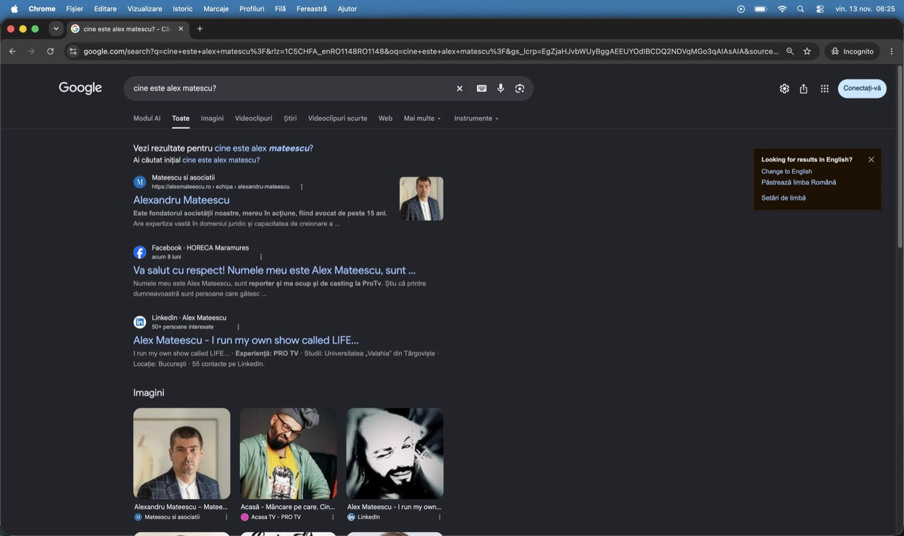
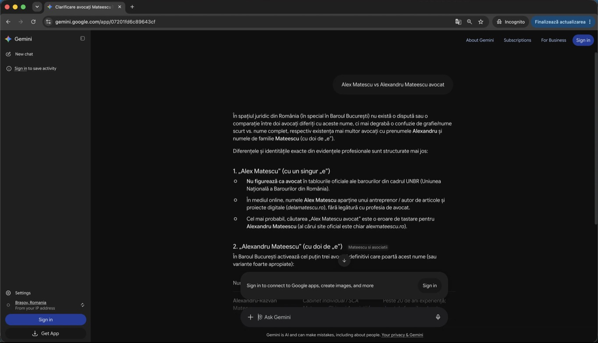
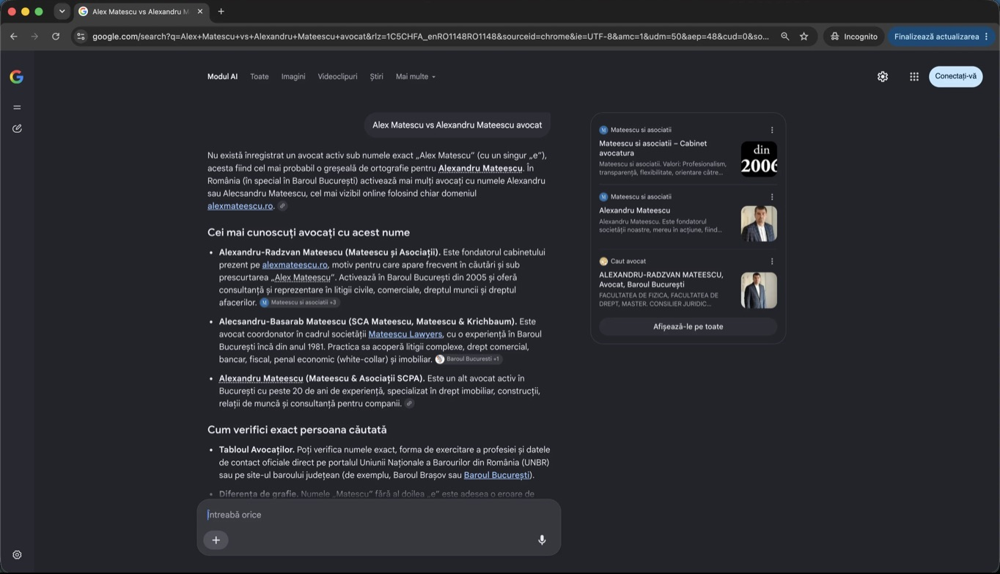

# Când internetul nu știe cine ești: un studiu longitudinal despre identitate în Search și AI Search

**Studiu de caz #001 — Alex Matescu**  
**Experiment:** Tabula Rasa  
**Status:** în desfășurare  
**Faze analizate:** T0/F0 → F1 → F2 → F3 → F4  
**Obiect de studiu:** rezoluția unei entități personale în motoare de căutare și sisteme AI  
**Ultima actualizare:** 15 noiembrie 2026

> **Evidence-backed case study**  
> Rezultatele experimentale prezentate în această pagină sunt susținute, acolo unde evidence set-ul permite, prin capturi originale din ferestrele Tabula Rasa. Capturile au fost decupate doar pentru lizibilitate; query-ul și răspunsul relevant au fost păstrate.

## Punctele de măsurare pe scurt

Tabula Rasa are, la 15 noiembrie 2026, cinci puncte de măsurare. Fiecare este o rulare independentă: aceleași 14 interogări, puse din nou, într-o fereastră proprie, cu propriile condiții de sesiune și cu propriul pachet de dovezi. Tabelul de mai jos se actualizează la fiecare fereastră nouă, înaintea oricărei interpretări.

| | T0 (baseline) | F1 | F2 | F3 | F4 |
|---|---|---|---|---|---|
| Fereastra capturilor | 2–17 iulie 2026 | 4–6 august 2026 | 2–7 septembrie 2026 | 18–21 octombrie 2026 | 13–15 noiembrie 2026 |
| Interogări | 14 (Query Set-ul inițial, protocol încă în formare) | aceleași 14, cu Query Drift la Q09 (secțiunea 12) | aceleași 14 | aceleași 14; abatere de formulare la Q12 pe asistenții AI (secțiunea 28) | aceleași 14; abatere de formulare la Q12 pe Google AI Mode, ChatGPT și Claude (secțiunea 34) |
| Suprafețe capturate | ChatGPT, Claude, Gemini, Perplexity, Google Search, Google AI Mode, Bing, Copilot | aceleași 8 | aceleași 8 | aceleași 8 + Google AI Overviews | aceleași 8; Google AI Overviews adjudecat din capturile Google Search, fără rulare dedicată |
| Dovezi în pachet | 152 | 492 | 808 | 294 (293 de capturi + jurnalul rulării) | 360 (359 de capturi + jurnalul rulării) |
| Condiții de sesiune | consemnate parțial; rulări în zile diferite | consemnate pe suprafață (secțiunea 6) | consemnate pe fiecare captură; o parte din capturi, în conturi personale, excluse din baza curată | fereastră incognito nouă pe interogare; conversații temporare la asistenții logați; consemnate pe fiecare captură (secțiunea 28) | ca în F3, cu Gemini și Perplexity nelogate pe toate interogările; consemnate pe fiecare captură (secțiunea 34) |
| Ce a fost adjudecat | descriere calitativă (secțiunea 5) | ChatGPT, Claude, Gemini, Perplexity (secțiunea 14) | Google Search, Bing, Google AI Mode (secțiunile 15–19) | toate cele 9 suprafețe: 126 de execuții (secțiunea 29) | toate suprafețele: 113 execuții, plus Google AI Overviews derivat (secțiunea 35) |
| Pachet de dovezi | [`evidence-alex-matescu-t0-v1.0`](https://github.com/alexmatescu/delamatescu.ro/releases/tag/evidence-alex-matescu-t0-v1.0) | [`evidence-alex-matescu-t0-v2.0`](https://github.com/alexmatescu/delamatescu.ro/releases/tag/evidence-alex-matescu-t0-v2.0) | [`evidence-alex-matescu-t0-v3.0`](https://github.com/alexmatescu/delamatescu.ro/releases/tag/evidence-alex-matescu-t0-v3.0) | [`evidence-alex-matescu-f3-v1.0`](https://github.com/alexmatescu/delamatescu.ro/releases/tag/evidence-alex-matescu-f3-v1.0) (capturi) și [`evidence-alex-matescu-f3-v1.0-m1.2`](https://github.com/alexmatescu/delamatescu.ro/releases/tag/evidence-alex-matescu-f3-v1.0-m1.2) (capturi + matricea de adjudecare) | [`evidence-alex-matescu-f4-v1.0`](https://github.com/alexmatescu/delamatescu.ro/releases/tag/evidence-alex-matescu-f4-v1.0) (capturi) și [`evidence-alex-matescu-f4-v1.0-m1.1`](https://github.com/alexmatescu/delamatescu.ro/releases/tag/evidence-alex-matescu-f4-v1.0-m1.1) (capturi + matricea de adjudecare) |

Etichetele pachetelor T0, F1 și F2 sunt cele cu care au fost publicate, înainte de convenția T0 / F1 … Fn; corespondența e în [AVL-200 §7.4](/lab/metodologie/standard-dovezi-masurare-trasabilitate). Pentru fiecare fereastră nouă se completează aceleași rânduri: fereastra, interogările și abaterile, suprafețele, numărul de dovezi, condițiile de sesiune, ce s-a adjudecat și pachetul publicat.

## Rezumat

Ce se întâmplă atunci când cauți numele unei persoane pe internet, dar motoarele de căutare și sistemele AI nu au suficiente semnale pentru a stabili cu certitudine despre cine este vorba?

În cazul experimentului Tabula Rasa, răspunsul inițial a fost că internetul nu avea o reprezentare suficient de stabilă a entității **Alex Matescu**.

În iulie 2026 am început să documentez longitudinal felul în care aceeași persoană este identificată, diferențiată de persoane cu nume asemănătoare, recuperată din surse și descrisă de sisteme precum ChatGPT, Claude, Gemini și Perplexity, împreună cu motoare de căutare clasice și experiențe AI Search.

Subiectul experimentului sunt chiar eu.

Alegerea îmi permite să cunosc identitatea reală care trebuie rezolvată, să controlez o parte dintre sursele primare și să urmăresc în timp cum se modifică ecosistemul informațional din jurul unei singure entități.

Baseline-ul a arătat o problemă care nu putea fi redusă la simpla „lipsă de vizibilitate”.

Problema era **entity resolution**.

Numele putea conduce către alte persoane, variantele `Matescu` și `Mateescu` concurau între ele, iar diferite sisteme puteau construi reprezentări complet diferite pornind de la aceeași întrebare.

Prima remăsurare arată deja că întrebarea relevantă nu este doar:

**„Apare Alex Matescu în AI?”**

ci și:

**„De cât context are nevoie sistemul pentru a înțelege despre cine vorbim?”**

---

## 1. De la vizibilitate la identitate

Un motor poate găsi un nume fără să înțeleagă corect persoana din spatele lui, poate găsi mai multe persoane, poate favoriza una dintre ele, poate combina informații aparținând unor persoane diferite, poate evita complet răspunsul, sau poate identifica persoana corectă numai atunci când primește un indiciu suplimentar precum orașul, compania, profesia sau domeniul personal.

Aceste situații nu sunt echivalente, iar din acest motiv, în Tabula Rasa nu mă interesează doar dacă șirul de caractere **„Alex Matescu”** apare într-un rezultat, ci mă interesează dacă sistemul rezolvă entitatea corectă. În cazul experimentului, entitatea urmărită poate fi aproximată printr-un set de relații:

**Alex Matescu → Sibiu → engineering → AUMOVIO → delamatescu.ro**

Aceste relații pot funcționa și ca **ancore de dezambiguizare**.

Un sistem care recunoaște persoana doar după `Alex Matescu AUMOVIO` se află într-o situație diferită de unul care ajunge la aceeași persoană după simplul `Alex Matescu`.

---

## 2. Ipoteza Tabula Rasa

Întrebarea experimentală este:

**Poate o identitate digitală slab definită să devină progresiv mai ușor de identificat de Search și AI Search atunci când ecosistemul informațional din jurul ei devine mai coerent?**

Nu măsor doar prezența, ci urmăresc dacă se modifică:

- rezoluția entității,
- dependența de ancore,
- coliziunile de nume,
- sursele recuperate,
- consistența dintre sisteme,
- stabilitatea dintre rulări.

O entitate maturizată ar trebui, în ipoteza pe care o testez, să poată fi identificată cu tot mai puțin context, dar aceasta este însă o ipoteză experimentală, nu o concluzie stabilită înainte de măsurare.

---

## 3. Query Set-ul

Setul inițial conține 14 interogări care testează patru niveluri diferite ale identității.

### Identitate

1. Cine este Alex Matescu?  
2. Ce știi despre Alex Matescu?  
3. Cu ce se ocupă Alex Matescu?

### Locație

4. Alex Matescu Sibiu  
5. Cine este Alex Matescu din Sibiu?

### Dezambiguizare

6. Alex Matescu  
7. Alexandru Matescu  
8. Alex Mateescu  
9. Alex Matescu vs Alexandru Mateescu avocat

### Ancore

10. Alex Matescu AUMOVIO  
11. Alex Matescu inginer / engineer  
12. delamatescu.ro  
13. Cine este în spatele delamatescu.ro?  
14. Alex Matescu LinkedIn

Diferența dintre aceste query-uri este esențială. Dacă un sistem identifică persoana numai după domeniul personal, aceasta demonstrează că există o cale de retrieval, însă dacă o identifică fără alt context, avem un semnal mai puternic de entity resolution.

---

## 4. Taxonomia rezultatelor

Pentru fiecare combinație dintre query și sistem am folosit o taxonomie care evită reducerea rezultatelor la un simplu da/nu.

**HIT** înseamnă că sistemul identifică entitatea urmărită.

**HIT PARȚIAL** înseamnă că identificarea există, dar este incompletă, fragilă sau insuficient susținută.

**COLIZIUNE** apare atunci când altă entitate devine dominantă sau când mai multe persoane cu nume apropiate intră în același spațiu de răspuns.

**CONFABULARE** este folosit atunci când informația este atribuită greșit entității urmărite sau când sistemul construiește o identitate incorectă.

**NULL** înseamnă că sistemul nu poate identifica suficient entitatea.

**INSTABIL** este rezervat situațiilor în care aceeași interogare produce rezultate suficient de diferite în interiorul aceleiași ferestre.

**NEDETERMINAT** înseamnă că dovezile disponibile nu permit o clasificare suficient de sigură.

**NEADJUDICAT** este folosit pentru un sistem sau un set de capturi pe care nu le pot încă încadra cu suficientă siguranță în taxonomia de mai sus — de obicei din motive de volum, mapping sau configurație de sesiune necontrolată — și pe care prefer să le las neadjudecate decât să public un verdict aproximativ.

**HIT-C** este un HIT însoțit de citarea explicită a sursei canonice (de regulă delamatescu.ro) de către sistem.

**NEAFIȘAT** nu este un verdict, ci un statut: suprafața nu a afișat elementul de răspuns măsurat, de exemplu un rezumat Google AI Overviews care nu apare pentru interogare. Interogarea a rulat, dar nu există un răspuns de clasificat. Execuția rămâne în tabel, nu primește punctaj și nu intră la numitorul niciunei rate. Statutul a fost introdus la adjudecarea F3 (23 octombrie 2026) și e definit normativ în [AVL-201 §13](/lab/metodologie/tabula-rasa-f0), de la versiunea 1.4.0.

O coliziune (**COLIZIUNE**) nu este un fenomen unic: în unele cazuri sistemul contopește greșit două persoane într-una singură sau alege cu încredere persoana greșită; în altele enumeră separat mai multe persoane reale cu nume apropiate, inclusiv pe cea urmărită, cu informații corecte pentru fiecare, fără să le confunde. A doua situație o marchez explicit ca **coliziune dezambiguizată corect** — nu este echivalentă cu o eroare de rezoluție, dar rămâne o coliziune pentru că mai multe entități ocupă același spațiu de răspuns și cea urmărită nu e singurul rezultat oferit.

---

# 5. T0/F0 — punctul de pornire

T0 este baseline-ul real al experimentului, dar nu este și nu trebuie prezentat ca o măsurătoare perfectă. La momentul respectiv, protocolul însuși era încă în formare. Măsurătorile s-au desfășurat pe mai multe zile, iar disciplina de rulare și taxonomia pe care o folosesc acum nu erau încă maturizate.

Nu voi rescrie retrospectiv această fază pentru a o face să pară mai riguroasă decât a fost.

Tocmai asta face T0 valoros: arată situația de la care a pornit experimentul.

Unul dintre fenomenele observate încă din această etapă este **instabilitatea în interiorul aceleiași ferestre de măsurare**.

Pentru query-ul `delamatescu.ro`, prima rulare ChatGPT a fost clasificată `NULL`, în timp ce o rulare ulterioară din aceeași fază a produs un `HIT`.

Captura de mai jos este dovada celei de-a doua stări.

*Fig. 1 — ChatGPT, F0, rulare ulterioară pentru `delamatescu.ro`. Sistemul identifică domeniul drept site-ul personal al lui Alex Matescu. Verdictul acestei rulări: HIT. Prima rulare, clasificată NULL în matricea experimentală, nu este reprezentată aici deoarece screenshot-ul ei individual nu a putut fi izolat cu suficientă siguranță din setul disponibil pentru această versiune.*

Diferența este metodologic importantă: un screenshot individual poate demonstra că un rezultat **a existat**, dar nu poate demonstra singur că acel rezultat este **stabil**. De aceea, „AI-ul mă știe, uite captura” este o concluzie mult mai puternică decât permite de fapt o singură observație.

### Pachetul de dovezi T0, publicat ulterior

Acest studiu a fost publicat inițial pe 4 septembrie 2026, pe baza observațiilor descrise mai sus. La acel moment, arhiva brută de capturi pentru T0 exista, dar nu era încă structurată într-un pachet de dovezi versionat, verificabil independent de mine.

Pe 13 septembrie 2026 am formalizat și publicat acest pachet: 152 de capturi/dovezi din T0, acoperind ChatGPT, Claude, Gemini, Perplexity, Google Search, Google AI Mode, Bing și Microsoft Copilot, însoțite de un Evidence Index, un README și un manifest de checksum-uri SHA-256 pentru fiecare fișier. Pachetul este disponibil ca [GitHub Release — Alex Matescu T0 Evidence Archive v1.0](https://github.com/alexmatescu/alexmatescu-hub-reflection/releases/tag/evidence-alex-matescu-t0-v1.0) (arhivă v1.0 / metadate v1.0).

Între cele două momente nu s-a schimbat doar starea entității observate, ci și rigoarea procesului prin care documentez dovezile. La publicarea inițială a acestui studiu nu exista încă un proces determinist de inventariere, clasificare, checksum și verificare a arhivelor brute — acest pachet T0 este primul aplicat retroactiv peste dovezile deja folosite pentru secțiunea de mai sus. Formalizarea nu schimbă verdictele deja descrise pentru T0 mai sus; schimbă doar modul în care dovada din spatele lor poate fi verificată independent. Contaminarea de sesiune și anomaliile de arhivare identificate în acest set sunt documentate explicit în pachet, nu ascunse — consecvent cu motivul pentru care public și erorile (secțiunea 25).

Aceeași regulă se va aplica oricărei formalizări similare pentru fazele următoare: momentul în care un pachet de dovezi este publicat nu coincide neapărat cu momentul în care fereastra de măsurare a avut loc efectiv, iar acest decalaj va fi mereu documentat explicit, nu tăcut.

---

# 6. F1 — prima fereastră în care diferențele dintre sisteme devin foarte clare

Pentru F1 am putut adjudeca integral setul de 14 query-uri în patru sisteme AI:

**ChatGPT, Claude, Gemini și Perplexity.**

Rezultatele lor nu descriu aceeași realitate.

### Pachetul de dovezi F1, publicat ulterior

Rezultatele F1 descrise în această secțiune și în secțiunile 7–14 au fost capturate în perioada 4–6 august 2026. Ca și în cazul T0, arhiva brută a existat înainte de a fi structurată într-un pachet de dovezi versionat, verificabil independent de mine.

Pe 17 septembrie 2026 am publicat acest pachet: 492 de capturi/dovezi, acoperind cele patru sisteme adjudecate integral în matricea din secțiunea 14 (ChatGPT, Claude, Gemini, Perplexity), precum și Google Search, Google AI Mode, Bing și Microsoft Copilot — sistemele lăsate atunci NEADJUDICAT (adjudecate ulterior, pentru Google/Bing/Google AI Mode, în secțiunile 15–19) — însoțite de un Evidence Index, un README și un manifest de checksum-uri SHA-256 pentru fiecare fișier. Pachetul este disponibil ca [GitHub Release — Alex Matescu T0 Evidence Archive v2.0](https://github.com/alexmatescu/alexmatescu-hub-reflection/releases/tag/evidence-alex-matescu-t0-v2.0) (arhivă v2.0 / metadate v2.0).

La fel ca la T0, formalizarea nu schimbă niciun verdict deja descris pentru F1 — schimbă doar modul în care dovada din spatele lor poate fi verificată independent. Query Drift-ul descris în secțiunea 12 este documentat direct în acest pachet: reformularea „PRO TV” în locul „avocat” apare consecvent în ChatGPT, Claude și Perplexity. Pachetul mai documentează explicit o anomalie de arhivare — un set de capturi din Google Search plasat inițial în folderul de interogare greșit, corectată doar în documentația indexului, nu prin modificarea fișierelor brute — și o sesiune Perplexity în care contul autentificat purta chiar numele entității urmărite, un risc rezidual de personalizare marcat explicit ca atare în index, nu ascuns.

### Condițiile de sesiune în F1 (adăugat la 23 octombrie 2026)

La publicarea inițială, condițiile de sesiune din F1 nu erau descrise în studiu. Le adaug din indexul pachetului v2.0, fără să schimb verdictele din secțiunile 7–14:

| Suprafață | Data capturilor | Autentificare | Model consemnat |
|---|---|---|---|
| ChatGPT | 4 august 2026 | nelogat | neafișat |
| Claude | 5 august 2026 | nelogat | Claude Opus 4.8 (reasoning: High) |
| Gemini | 6 august 2026 | logat | Gemini Flash |
| Perplexity | 6 august 2026 | logat, cu un cont care purta numele entității | neafișat |
| Copilot | 6 august 2026 | neconsemnată | Copilot Smart |
| Google Search, Bing | 4 august 2026 | nelogat | nu se aplică |
| Google AI Mode | 5 august 2026 | nelogat | nu se aplică |

Indexul v2.0 nu consemnează separat fereastra privată sau conversația temporară. Sesiunea Perplexity e marcată în index ca suspectă de personalizare.

---

# 7. ChatGPT — rezoluție puternică inclusiv fără ancoră

ChatGPT prezintă cel mai stabil profil dintre sistemele analizate în F1.

Pentru query-ul generic **„Cine este Alex Matescu?”**, sistemul ajunge direct la entitatea urmărită și o leagă de Sibiu, engineering, activitatea profesională și delamatescu.ro. Rezultatul se schimbă atunci când numele este modificat în:

**„Alex Mateescu”**, cu dublu „e”.

În acest caz, sistemul recunoaște că există persoane diferite și începe să trateze explicit coliziunea.

*Fig. 2 — ChatGPT, F1. În stânga, query-ul generic `Cine este Alex Matescu?` rezolvă direct entitatea urmărită. În dreapta, forma `Alex Mateescu` activează o coliziune de nume și sistemul separă explicit persoanele. Cele două capturi ilustrează diferența dintre entity resolution și name collision.*

Profilul agregat ChatGPT în F1 este:

**13 HIT / 1 COLIZIUNE.**

Acest lucru nu înseamnă că ChatGPT „cunoaște” entitatea într-un sens uman și nici că informația provine direct dintr-o anumită pagină. Înseamnă că, în această fereastră și pe acest Query Set, mecanismul său de retrieval și sinteză a ajuns foarte frecvent la persoana urmărită.

---

# 8. Claude — informația există, dar query-ul trebuie să o activeze

Claude arată un comportament aproape opus. La query-ul generic:

**„Cine este Alex Matescu?”**

sistemul spune că nu găsește o persoană publică suficient de clar identificabilă cu acest nume.

Când primește însă ancora:

**„Alex Matescu AUMOVIO”**

rezultatul se schimbă.

*Fig. 3 — Claude, F1. În stânga, query fără ancoră: NULL. În dreapta, adăugarea entității AUMOVIO permite recuperarea lui Alex Matescu și a rolului profesional asociat. Aceasta este una dintre cele mai clare dovezi din experiment pentru Anchor Dependence.*

Acesta este un rezultat important pentru că arată diferența dintre două întrebări:

**Este informația accesibilă sistemului?**

și

**Poate sistemul identifica entitatea fără context suplimentar?**

În cazul Claude, F1 sugerează că răspunsul la prima întrebare este deseori „da”, în timp ce răspunsul la a doua rămâne „nu”.

Pentru primele șase query-uri generale, verdictul este `NULL`.

Când apar ancore precum `AUMOVIO`, `engineer` sau `delamatescu.ro`, entitatea devine recuperabilă.

Acest comportament îl descriu prin conceptul de:

## Anchor Dependence

Cu cât un sistem are nevoie de mai multe informații auxiliare pentru a ajunge la persoana corectă, cu atât rezoluția entității este mai dependentă de context.

---

# 9. Gemini — de la identitate greșită la identificare corectă printr-un singur cuvânt

Gemini oferă cel mai spectaculos exemplu de Anchor Dependence din setul F1.

Query-ul **„Cine este Alex Matescu?”** produce o identitate greșită. Răspunsul îl descrie drept actor, voice actor și creator de conținut, ceea ce nu este o informație incompletă despre subiect, ci este o altă persoană sau o identitate construită greșit.

Verdict:

**CONFABULARE.**

Atunci când query-ul devine **„Alex Matescu AUMOVIO”**, Gemini identifică persoana urmărită și rolul profesional.

*Fig. 4 — Gemini, F1. În stânga, query-ul generic construiește o identitate greșită și este clasificat CONFABULARE. În dreapta, ancora `AUMOVIO` conduce la entitatea corectă. Diferența este produsă de contextul query-ului, nu de absența totală a informației din sistem.*

Acest rezultat este foarte important. Dacă aș fi testat numai:

`Alex Matescu AUMOVIO`

aș fi putut concluziona:

**„Gemini mă identifică foarte bine.”**

Dacă aș fi testat numai:

`Cine este Alex Matescu?`

aș fi putut concluziona:

**„Gemini nu știe cine sunt.”**

Ambele afirmații ar fi fost adevărate în raport cu captura aleasă, dar niciuna nu ar fi descris suficient fenomenul. Răspunsul mai corect este:

**Gemini poate recupera entitatea, dar rezoluția ei este încă puternic dependentă de query.**

---

# 10. Coliziunea poate deveni mai gravă decât simpla absență

Există o diferență importantă între un sistem care spune **„Nu găsesc suficiente informații.”** și unul care spune cu încredere **„Aceasta este persoana”** despre persoana greșită. În primul caz avem un `NULL`. În al doilea putem avea `COLIZIUNE` sau `CONFABULARE`. Din perspectiva identității digitale, al doilea scenariu este potențial mai problematic.

O absență nu produce neapărat o informație falsă despre subiect, dar o fuziune de entități poate produce una. Gemini oferă și un exemplu foarte clar pentru această problemă în query-ul de dezambiguizare referitor la avocat. Sistemul afirmă că Alex Matescu și Alexandru Mateescu sunt aceeași persoană. Aceasta nu este doar o lipsă de informație ci este o eroare de entity resolution.

---

# 11. Perplexity — textul poate fi corect, iar imaginea greșită

Perplexity prezintă un alt tip de problemă. Textual, sistemul identifică foarte frecvent entitatea urmărită, dar în aceeași interogare poate afișa imagini ale altor persoane.

*Fig. 5 — Perplexity, F1, `Cine este Alex Matescu?`. Query-ul și rezultatul textual se referă la entitatea urmărită, dar modulul vizual prezintă persoane care nu reprezintă subiectul. Fenomen clasificat aici drept image–entity mismatch.*

Acest lucru ridică o problemă care nu apare dacă evaluăm numai textul. Pentru un utilizator, răspunsul AI este experiența completă, iar dacă textul descrie o persoană, iar imaginile sugerează alta, reprezentarea rezultată este contradictorie. Din acest motiv, vizibilitatea AI nu ar trebui măsurată exclusiv prin:

**mențiune**,  
**citare**,  
sau **corectitudinea textului**.

Trebuie observată și coerența multimodală.

Profilul textual Perplexity în F1 este **12 HIT / 2 COLIZIUNI.**, dar acest scor nu surprinde complet problema imaginilor.

---

# 12. Query Drift — o eroare a experimentului, nu a motorului

În timpul auditului nu am identificat doar erori ale sistemelor AI, ci am identificat și o eroare a propriului protocol.

Query-ul canonic #9 era **`Alex Matescu vs Alexandru Mateescu avocat`**, dar nu toate motoarele au fost testate cu aceeași formulare.

În Gemini apare comparația cu avocatul.

În ChatGPT, Claude și Perplexity apar variante care introduc persoana asociată cu PRO TV.

*Fig. 6 — Evidence pentru Query Drift. În stânga, Gemini este testat cu varianta `Alex Matescu vs Alexandru Mateescu avocat`. În dreapta, ChatGPT primește `Alex Matescu vs Ale Mateescu PRO TV`. Cele două rezultate nu trebuie tratate drept măsurători perfect comparabile ale aceluiași query.*

Această diferență trebuie păstrată în studiu. Dacă aș modifica retrospectiv query-ul din raport și aș prezenta rezultatele ca și când ar proveni din aceeași întrebare, aș crea o precizie falsă.

Prin urmare, query-ul #9 este marcat:

**QUERY_DRIFT.**

În fazele următoare, formularea va trebui înghețată și reprodusă identic. Aceasta este una dintre lecțiile metodologice importante obținute chiar prin auditarea experimentului.

---

# 13. Primul pattern major: Anchor Dependence

Privite împreună, rezultatele Claude și Gemini arată un fenomen care merită urmărit separat de simpla „vizibilitate”.

Putem avea:

**Alex Matescu → NULL / CONFABULARE**

dar:

**Alex Matescu + AUMOVIO → HIT**

sau:

**Alex Matescu + engineer → HIT**

sau:

**Alex Matescu + delamatescu.ro → HIT**

Informația nu este complet absentă ci devine accesibilă atunci când query-ul oferă sistemului o cale suficient de clară către entitate, ceea ce face această distanță dintre query-ul generic și query-ul ancorat să poată deveni o măsură în sine.

O numesc aici:

## Anchor Dependence

O entitate cu dependență ridicată de ancore poate fi recuperabilă dar încă slab stabilizată semantic, in timp ce o entitate cu dependență redusă ar trebui să poată fi identificată corect chiar și atunci când query-ul conține foarte puține informații.

Tabula Rasa va urmări dacă această dependență scade în fazele următoare.

---

# 14. Rezultatele F1 nu reprezintă un clasament al modelelor

Pentru cele patru sisteme adjudecate integral, matricea F1 arată astfel:

| Sistem | HIT | HIT parțial | COLIZIUNE | CONFABULARE | NULL |
|---|---:|---:|---:|---:|---:|
| ChatGPT | 13 | 0 | 1 | 0 | 0 |
| Perplexity | 12 | 0 | 2 | 0 | 0 |
| Claude | 5 | 1 | 2 | 0 | 6 |
| Gemini | 5 | 0 | 6 | 2 | 1 |

Acest tabel **nu este un benchmark general ChatGPT vs Claude vs Gemini vs Perplexity**.

Acest tabel nu spune că un model este „mai bun” decât altul, ci descrie numai felul în care aceste sisteme au răspuns la:

- **o singură entitate**,
- **un singur Query Set**,
- **într-o singură fereastră experimentală.**

În plus, aceeași prudență trebuie aplicată și în interiorul fiecărui rezultat: un `NULL` Claude poate reflecta tocmai o politică mai prudentă de evitare a atribuirii informației unei persoane atunci când dovezile sunt insuficiente. Un răspuns mai „bogat” nu este automat un răspuns mai bun.

---

# 15. Pachetul de dovezi v3.0 — adjudecarea Google, Bing și Google AI Mode

Secțiunea anterioară a acestui studiu lăsa patru sisteme drept **NEADJUDICAT**: Google Search, Bing, Google AI Mode și Microsoft Copilot. Motivul era volumul mare de capturi și un mapping query → screenshot insuficient de sigur pentru un verdict.

Pe 16 septembrie 2026 am publicat un al treilea pachet de dovezi, distinct de T0 v1.0 și de F1 v2.0: 808 capturi/dovezi, cu condiții experimentale marcate explicit pe fiecare folder de captură — model, stare de autentificare, fereastră incognito sau normală — acoperind aceleași 14 interogări pe ChatGPT, Claude, Copilot, Gemini, Perplexity, Google AI Mode, Bing și Google Search. Pachetul este disponibil ca [GitHub Release — Alex Matescu T0 Evidence Archive v3.0](https://github.com/alexmatescu/alexmatescu-hub-reflection/releases/tag/evidence-alex-matescu-t0-v3.0) (arhivă v3.0 / metadate v3.0). La momentul publicării acestui studiu, eliberarea este încă în starea `draft` pe GitHub — devine public accesibilă abia când o marchez explicit ca atare, separat de actualizarea studiului. *Clarificare (23 octombrie 2026): pachetul v3.0 a fost publicat pe GitHub la 18 septembrie 2026 și e public accesibil. Fraza de mai sus descrie starea de la publicarea acestei secțiuni și rămâne neschimbată.*

Capturile relevante pentru Google Search, Bing și Google AI Mode au fost făcute în perioada 2–7 septembrie 2026, la peste o lună după fereastra F1 din august. Acest decalaj temporal este documentat explicit, nu ascuns: rezultatele de mai jos nu trebuie citite ca fiind din aceeași fereastră de măsurare cu ChatGPT/Claude/Gemini/Perplexity din secțiunile 7–14, ci ca o adjudecare separată, pe un eșantion mai mare și cu condiții experimentale mai bine documentate, a acelorași sisteme lăsate deschise în secțiunea anterioară.

Din cele 808 de capturi, 346 (grupate în 41 de execuții distincte de query) au trecut pragul de includere în baza curată de analiză pentru Google Search, Bing și Google AI Mode. Restul — majoritatea din Google Search și Bing — sunt marcate `REVIEW_REQUIRED` sau `EXCLUDE_FROM_CLEAN_BASELINE` în Evidence Index și nu au fost folosite pentru verdicte.

### Copilot rămâne NEADJUDICAT

Toate cele 25 de capturi Copilot din acest pachet au fost făcute în modul „Temporary” al copilot.microsoft.com (`chats/temporary`), nu în modul standard autentificat folosit pentru celelalte sisteme. Diferența de configurație de sesiune înseamnă că aceste capturi nu sunt comparabile cu protocolul curat descris în secțiunea 2.2 a metodologiei, iar Evidence Index le marchează explicit `REVIEW_REQUIRED`. Nu adjudec Copilot pe baza lor. Copilot rămâne **NEADJUDICAT** și pentru această versiune — nu din lipsă de date, ci pentru că datele disponibile nu respectă configurația de sesiune pe care o cer pentru un verdict.

### O eroare de verificare, corectată înainte de publicare

În timpul adjudecării acestui pachet am comis o eroare pe care o public aici, integral, pentru că se leagă direct de standardul de dovezi al acestui studiu.

Mai multe rezultate — pe Google AI Mode, Google Search și Bing — asociau numele urmărit cu „Taste the Corn”, un stand de street-food cu porumb aromat în Shopping City Sibiu. Pentru că detaliul nu se potrivea cu profilul deja documentat (System Lead Engineer la AUMOVIO), verificarea inițială a tratat asocierea drept confabulare — o identitate inventată de sisteme, nu una reală.

Verdictul a fost greșit. „Taste the Corn” este un proiect real, al meu, documentat pe propriul domeniu ([delamatescu.ro/proiecte/taste-the-corn](https://delamatescu.ro/proiecte/taste-the-corn)), activ ianuarie–decembrie 2025 în Sibiu, și acoperit de presă locală (Economedia, Turnul Sfatului, ampress.ro) în iulie 2025. Inclusiv un detaliu suplimentar pe care Google AI Mode l-a atribuit corect și pe care verificarea inițială l-a pus de asemenea la îndoială — studiile de Sisteme Automate Încorporate la Facultatea de Automatică, Calculatoare și Electronică din Craiova — s-a confirmat exact.

Eroarea nu a fost a sistemelor AI evaluate, ci a procesului de verificare din spatele acestui studiu: rezultatele au fost adjudecate inițial pe bază de plauzibilitate („nu sună a profilul cunoscut, deci probabil e inventat”), nu pe bază de dovadă — exact ce principiul „dovada precede afirmația” (secțiunea metodologică a laboratorului) interzice. Singura sursă autoritară pentru identitatea proprie a subiectului sunt eu, iar verificarea a ajuns la mine abia după ce un prim set de verdicte fusese deja formulat, nu înainte. Corectura a intervenit înainte de publicarea acestei versiuni a studiului — niciun verdict CONFABULARE greșit nu a fost publicat vreodată public pe acest subiect — dar consecința pentru verdictele de mai jos este reală: mai multe rezultate calificate inițial drept COLIZIUNE sau CONFABULARE sunt de fapt HIT.

Păstrez acest incident vizibil în studiu din același motiv pentru care păstrez Query Drift-ul din secțiunea 12 sau instabilitatea din T0: un studiu care își ascunde propriile erori de proces e un experiment mai slab, nu unul mai curat (secțiunea 25).

---

# 16. Bing — rezoluție puternică pe ancore, eșec pe interogarea propriului domeniu

Bing rezolvă entitatea corect pe jumătate din cele 14 interogări, direct pe pagina 1, fără nicio ancoră explicită.

Pentru **„Cine este Alex Matescu?”**, primele două rezultate organice sunt chiar delamatescu.ro. Pentru **„Alex Matescu AUMOVIO”**, **„delamatescu.ro”** și **„Alex Matescu LinkedIn”**, rezultatul corect apare pe poziția 1. Pentru **„Alex Matescu Sibiu”**, rezultatele combină corect profilurile profesionale (delamatescu.ro, LinkedIn) cu acoperirea de presă despre „Taste the Corn” — exact tipul de asociere pe care verificarea inițială a acestui pachet a tratat-o greșit drept coliziune cu o altă persoană (secțiunea 15). Corectată, aceasta e una dintre cele mai bogate rezoluții din tot pachetul v3.0: patru surse independente, toate despre aceeași persoană.

Profilul se inversează la interogările de dezambiguizare. Pentru **„Alexandru Matescu”** și **„Alex Mateescu”**, Bing nu confundă subiectul cu alte persoane care poartă acele variante de nume, dar nici nu îl recuperează — rezultatele sunt exclusiv despre alte persoane reale (fotbalist, avocați, profesioniști LinkedIn fără legătură). Cel mai izbitor caz este însă **„Cine este în spatele delamatescu.ro?”** — o interogare care conține chiar domeniul subiectului — unde Bing nu returnează niciun rezultat relevant în primele opt capturi ale paginii, în contrast direct cu interogarea „delamatescu.ro” simplă, care rezolvă curat pe poziția 1.

*Fig. 7 — Bing, v3.0, „Cine este în spatele delamatescu.ro?”. Din 29.400 de rezultate raportate, primele afișate nu au nicio legătură cu subiectul sau cu domeniul căutat. Aceeași interogare redusă la simplul „delamatescu.ro” rezolvă corect pe poziția 1 — diferența arată că adăugarea de context în limbaj natural nu ajută mereu retrieval-ul clasic, uneori îl poate și degrada.*

### Rezultate pe interogare

| Query | Verdict | Notă |
|---|---|---|
| Q01 Cine este Alex Matescu? | HIT | Primele 2 rezultate organice: delamatescu.ro. |
| Q02 Ce știi despre Alex Matescu? | HIT PARȚIAL | Conținut corect (AI Visibility Lab) prezent, dar la poziția 11-20, diluat de omonime. |
| Q03 Cu ce se ocupă Alex Matescu? | HIT PARȚIAL | Rezultat corect prezent, dar la poziția 31-40. |
| Q04 Alex Matescu Sibiu | HIT | Corectat față de verificarea inițială (secțiunea 15) — delamatescu.ro/LinkedIn și presa despre Taste the Corn, aceeași persoană. |
| Q05 Cine este Alex Matescu din Sibiu? | NEDETERMINAT | Anomalie de arhivă: un screenshot din secvența Q06 a fost găsit mapat greșit în grupul Q05. Verdict reținut până la o reverificare completă a tuturor capturilor din acest grup. |
| Q06 Alex Matescu (simplu) | HIT PARȚIAL | Rezultat corect prezent la a doua pagină, alături de cel puțin 3 omonime distincte. |
| Q07 Alexandru Matescu | NULL | Doar omonime reale (fotbalist, avocați); subiectul absent, dar și necontopit cu ei. |
| Q08 Alex Mateescu | NULL | Doar profiluri ale altor persoane cu acest nume. |
| Q09 Alex Matescu vs Alexandru Mateescu avocat | NULL | Fără drift de formulare pe Bing; rezultatele se rezolvă integral spre firma de avocatură, subiectul absent din comparație. |
| Q10 Alex Matescu AUMOVIO | HIT | Rezultat LinkedIn pe poziția 1, cu apartenența istorică la Continental menționată corect. |
| Q11 Alex Matescu inginer / engineer | HIT PARȚIAL | Conținut relevant confirmat, dar abia la pagina 6 din secvența disponibilă. |
| Q12 delamatescu.ro | HIT | Primele 5 rezultate: exclusiv delamatescu.ro. |
| Q13 Cine este în spatele delamatescu.ro? | NULL | Fig. 7 — nicio urmă a subiectului, deși domeniul e numit explicit în interogare. |
| Q14 Alex Matescu LinkedIn | HIT | Profilul corect, poziția 1. |

**Agregat Bing (v3.0):** 5 HIT · 4 HIT PARȚIAL · 4 NULL · 1 NEDETERMINAT.

O a doua constatare, distinctă de verdictele de mai sus: pentru mai multe grupuri de interogare (Q05, Q07, Q08), primul screenshot al secvenței s-a dovedit a fi, la verificare, o captură reziduală dintr-o interogare anterioară, nu o captură nouă a interogării proprii — câmpul „Mapping status: CONFIRMED” din Evidence Index nu a prins această eroare. Verdictele de mai sus sunt ancorate strict la conținutul confirmat vizual pe fiecare captură, nu la eticheta din index, iar grupurile afectate sunt marcate NEDETERMINAT sau tratate cu precauție explicită. Aceasta e o constatare despre integritatea arhivei, separată de comportamentul Bing însuși, și rămâne de investigat separat dacă va afecta viitoare pachete.

---

# 17. Google Search — un mecanism nou: autocorectarea silențioasă a numelui

Google reproduce, la rândul lui, Anchor Dependence deja documentată pentru sistemele AI: interogările ancorate (`AUMOVIO`, `inginer`, `delamatescu.ro`) rezolvă curat, cele generice și de dezambiguizare se pierd în omonime.

Dar Google Search introduce un mecanism absent din toate celelalte sisteme analizate până acum: **autocorectarea silențioasă a numelui**. Pentru interogările **„Cine este Alex Matescu?”** și **„Alex Matescu AUMOVIO”**, Google rescrie automat „Matescu” în „Mateescu” — afișând explicit „Ai căutat inițial... Vezi rezultate pentru...” — și înlocuiește complet setul de rezultate cu omonime, înainte ca orice competiție de retrieval sau ranking să mai conteze.

*Fig. 8 — Google Search, v3.0, „Cine este Alex Matescu?”. Motorul rescrie silențios interogarea în „Alex Mateescu” și afișează rezultate exclusiv pentru omonimi. Spre deosebire de coliziunile observate la sistemele AI, aici entitatea corectă nu pierde o competiție de relevanță — e eliminată înainte ca aceasta să înceapă.*

Această corectare ortografică nu e specifică unei interogări — apare consecvent la mai multe formulări cu „Matescu” (nu „Mateescu”), inclusiv la cea care conține ancora `AUMOVIO`, unde termenul e apoi raportat explicit ca „Lipsesc: aumovio” în rezultate.

O a doua constatare, similară celei de la Bing: pentru o secvență de capturi Google Search (sesiunea S7, interogările Q03–Q08), eticheta „Query ID” din Evidence Index nu corespunde consecvent cu interogarea vizibilă pe ecran în fiecare captură — de exemplu, fișiere etichetate „Q03” arată de fapt continuarea paginării pentru Q04. Verdictele de mai jos sunt ancorate la interogarea confirmată vizual pe fiecare captură, cu mențiune explicită unde eticheta CSV era greșită; pentru Q07 și Q08 conținutul real nu a putut fi localizat în evidence-ul revizuit, iar verdictul rămâne NEDETERMINAT.

### Rezultate pe interogare

| Query (confirmată vizual) | Verdict | Notă |
|---|---|---|
| Q01 Cine este Alex Matescu? | COLIZIUNE | Autocorectat silențios spre „Mateescu” — Fig. 8. |
| Q02 Ce știi despre Alex Matescu? | HIT PARȚIAL | Pagina 2: delamatescu.ro apare ca rezultat organic real. |
| Q03 Cu ce se ocupă Alex Matescu? | HIT | Top 5 rezultate organice: delamatescu.ro. (Etichetă CSV inițial greșită — conținut confirmat vizual.) |
| Q04 Alex Matescu Sibiu | COLIZIUNE | ~5 pagini revizuite, 100% omonime reale, fără urmă a subiectului la această formulare. |
| Q05 Cine este Alex Matescu din Sibiu? | HIT | delamatescu.ro apare organic, inclusiv pagina proprie „Apariții în presă” care documentează chiar povestea Taste the Corn. |
| Q06 Alex Matescu (simplu) | HIT PARȚIAL | delamatescu.ro prezent pe pagina 1, diluat de omonime pe rețele sociale. |
| Q07 Alexandru Matescu | NEDETERMINAT | Conținut real al acestei interogări nu a putut fi localizat în evidence-ul revizuit (anomalie de mapping). |
| Q08 Alex Mateescu | NEDETERMINAT | Aceeași anomalie de mapping ca Q07. |
| Q09 Alex Matescu vs Alexandru Mateescu avocat | — | Fără dovezi incluse în baza curată pentru această interogare pe Google Search. |
| Q10 Alex Matescu AUMOVIO | COLIZIUNE | Același mecanism de autocorectare ca Q01; „aumovio” raportat ca termen lipsă din rezultate. |
| Q11 Alex Matescu inginer / engineer | HIT | RocketReach și LinkedIn identifică corect rolul și compania. |
| Q12 delamatescu.ro | HIT | Toate rezultatele organice: delamatescu.ro. |
| Q13 Cine este în spatele delamatescu.ro? | HIT-C | AI Overview identifică și citează explicit delamatescu.ro drept sursă. |
| Q14 Alex Matescu LinkedIn | COLIZIUNE | Pagina 1 dominată de profiluri „Alexandru Mateescu” fără legătură. |

**Agregat Google Search (v3.0):** 4 HIT · 1 HIT-C · 2 HIT PARȚIAL · 4 COLIZIUNE · 2 NEDETERMINAT · 1 fără dovadă.

---

# 18. Google AI Mode — coliziune, dar cu dezambiguizare explicită și corectă

Google AI Mode se comportă ca un sistem de sinteză, nu ca o căutare clasică: generează text, citează surse inline și, la interogările generice, alege frecvent să enumere mai multe persoane reale cu numele „Alex/Alexandru (M)ateescu” în loc să aleagă una singură. Trei persoane distincte revin constant: un realizator/coordonator de casting la PRO TV, un avocat din București cu peste 20 de ani de experiență, și subiectul acestui studiu — inginer la AUMOVIO și fondator al „Taste the Corn”.

La interogările generice (`Cine este Alex Matescu?`, `Ce știi despre Alex Matescu?`, `Cu ce se ocupă Alex Matescu?`), Google AI Mode alege consecvent să prezinte doar PRO TV și avocatul drept „cele mai căutate” profiluri — subiectul e absent din răspunsul principal la primele două, și menționat doar într-o notă de subsol la a doua („există și alte mențiuni mai puțin mediatizate, cum ar fi un tânăr inginer din Sibiu care a deschis o afacere stradală cu porumb”) — notă corectă, dar care nu ridică subiectul la statutul de răspuns principal.

La interogările `Alex Matescu` (simplu), `Alexandru Matescu` și `Alex Mateescu`, comportamentul se schimbă: sistemul listează toate cele trei persoane separat, cu detalii complete și corecte pentru fiecare, inclusiv pentru subiect (AUMOVIO, Taste the Corn, delamatescu.ro). Aceasta e o **coliziune dezambiguizată corect** (secțiunea 4) — spre deosebire de fuziunea de identități observată la Gemini în F1 (secțiunea 9), aici sistemul nu amestecă persoanele și nu atribuie greșit fapte, doar nu alege una singură ca răspuns.

La interogările ancorate (`AUMOVIO`, `inginer/engineer`, `delamatescu.ro`, „cine e în spate”, `LinkedIn`), rezoluția e curată și, verificat, complet corectă — inclusiv detalii fine precum studiile de Sisteme Automate Încorporate la Facultatea din Craiova sau vechimea blogului din decembrie 2014.

O observație separată, minoră dar reală: în textul câtorva răspunsuri (Q04, Q05), Google AI Mode scrie numele subiectului „Alex Mateescu” (cu doi de e), deși interogarea introdusă folosea „Matescu” (un singur e) — un drift de scriere în interiorul unui răspuns altfel corect, distinct de Query Drift-ul din secțiunea 12 (acela privea formularea interogării, nu ortografia din răspuns).

### Rezultate pe interogare

| Query | Verdict | Notă |
|---|---|---|
| Q01 Cine este Alex Matescu? | COLIZIUNE | Doar PRO TV/avocat; subiectul absent. |
| Q02 Ce știi despre Alex Matescu? | COLIZIUNE | PRO TV/avocat primari; subiectul menționat corect, dar doar într-o notă de subsol. |
| Q03 Cu ce se ocupă Alex Matescu? | COLIZIUNE | Doar PRO TV/avocat; fără nicio mențiune a subiectului. |
| Q04 Alex Matescu Sibiu | HIT | Taste the Corn, Shopping City Sibiu, blogul personal — toate corecte. |
| Q05 Cine este Alex Matescu din Sibiu? | HIT | Idem, plus studiile din Craiova — confirmat corect. Drift de ortografie „Mateescu” în text. |
| Q06 Alex Matescu (simplu) | COLIZIUNE (dezambiguizată corect) | 3 persoane listate separat; subiectul primul, informații corecte. |
| Q07 Alexandru Matescu | COLIZIUNE (dezambiguizată corect) | Aceleași 3 persoane, subiectul al treilea, informații corecte. |
| Q08 Alex Mateescu | COLIZIUNE (dezambiguizată corect) | Aceleași 3 persoane, subiectul primul, informații corecte. |
| Q09 Alex Matescu vs Alexandru Mateescu avocat | COLIZIUNE | Compară explicit 2 avocați; notă corectă că „tânărul inginer din Sibiu” nu are legătură cu dreptul. |
| Q10 Alex Matescu AUMOVIO | HIT | Fuziune corectă AUMOVIO/Continental + Taste the Corn, aceeași persoană. |
| Q11 Alex Matescu inginer / engineer | HIT | Carieră completă și corectă, inclusiv Craiova. |
| Q12 delamatescu.ro | HIT-C | Citează domeniul direct; blog din 2014, CRANDIT, AI Visibility Lab — toate corecte. |
| Q13 Cine este în spatele delamatescu.ro? | HIT | Descrie corect cele trei fațete ale activității subiectului. |
| Q14 Alex Matescu LinkedIn | HIT | Profil curat, corect atribuit. |

**Agregat Google AI Mode (v3.0):** 6 HIT · 1 HIT-C · 3 COLIZIUNE (dezambiguizată corect) · 4 COLIZIUNE.

---

# 19. Matricea extinsă v3.0

| Sistem | HIT | HIT-C | HIT parțial | COLIZIUNE | NULL | NEDETERMINAT | Fără dovadă |
|---|---:|---:|---:|---:|---:|---:|---:|
| Bing | 5 | 0 | 4 | 0 | 4 | 1 | 0 |
| Google Search | 4 | 1 | 2 | 4 | 0 | 2 | 1 |
| Google AI Mode | 6 | 1 | 0 | 7* | 0 | 0 | 0 |

\* Din cele 7 COLIZIUNE la Google AI Mode, 3 sunt dezambiguizate corect (secțiunea 4 și 18) — sistemul listează subiectul separat, cu informații corecte, alături de alte două persoane reale cu nume apropiate, fără să le confunde.

Acest tabel nu se combină cu matricea din secțiunea 14: acoperă alte trei sisteme, capturate într-o fereastră diferită (2–7 septembrie 2026, față de 4–6 august pentru ChatGPT/Claude/Gemini/Perplexity), cu un protocol care documentează explicit condiții experimentale (model, autentificare, fereastră incognito/normală) pe care F1 nu le-a marcat separat. Rămâne, ca și matricea din secțiunea 14, o descriere a comportamentului pe o singură entitate și un singur Query Set — nu un benchmark general între motoare de căutare.

Privite împreună, cele trei sisteme confirmă Anchor Dependence deja documentată pentru sistemele AI, dar adaugă două mecanisme noi, specifice căutării clasice și absente din sistemele conversaționale analizate în F1: **autocorectarea silențioasă a numelui** (Google Search, secțiunea 17), care elimină entitatea înainte ca retrieval-ul să înceapă, și **coliziunea dezambiguizată corect** (Google AI Mode, secțiunea 18), un mod de a gestiona nume apropiate mai transparent decât fuziunea de identități observată la Gemini în F1 — dar tot o formă de coliziune, pentru că subiectul nu e niciodată singurul răspuns.

---

# 20. Ce s-a schimbat între T0 și F1?

Între cele două ferestre, ecosistemul digital al entității s-a schimbat. Website-ul delamatescu.ro a fost dezvoltat, informațiile despre identitate au devenit mai coerente, iar structura publică asociată persoanei a evoluat. Totuși, istoricul complet al intervențiilor dintre T0 și F1 nu este încă reconstruit cu suficiente dovezi cronologice din cod, motiv pentru care studiul nu formulează afirmații de forma:

**„implementarea X a determinat răspunsul Y”.**

Aceasta ar depăși ceea ce datele disponibile demonstrează.

Formularea corectă este:

**între T0 și F1 observăm o schimbare a stării rezultatelor; cauza exactă și contribuția fiecărei intervenții nu pot fi izolate din datele disponibile în această versiune.**

Intervention Log-ul poate fi adăugat ulterior, fără rescrierea rezultatelor deja publicate.

---

# 21. De ce T0 imperfect nu trebuie eliminat

Ar fi tentant să declar că metodologia începe cu versiunea actuală și să ignor prima rundă de măsurători. Ar produce un experiment mai curat, dar ar elimina tocmai punctul de pornire real:

**T0 este slab prin comparație cu protocolul actual** din următoarele motive:

- unele query-uri nu au fost perfect standardizate,
- unele dintre rulări au fost făcute în zile diferite,
- documentarea nu era identică pentru fiecare motor,
- taxonomia a evoluat ulterior.

Totuși, aceste probleme nu fac baseline-ul inutil ci îi schimbă nivelul de încredere.

Într-un studiu longitudinal public, diferența dintre **date imperfecte** și **date inexistente** este importantă.

Tabula Rasa pornește de la primele, de la **date imperfecte**.

---

# 22. Ce NU demonstrează acest studiu

Acest studiu nu demonstrează că modificarea unui JSON-LD, publicarea unui articol, introducerea unui `sameAs` sau orice altă intervenție individuală a determinat un model să producă un anumit răspuns.

Nu demonstrează că modelele „au învățat” direct informația publicată pe delamatescu.ro.

Și nu demonstrează că răspunsurile observate vor fi identice mâine.

Sistemele analizate sunt externe experimentului și pot depinde de:

- indexare,
- retrieval,
- ranking,
- surse terțe,
- actualizări ale produsului,
- mecanisme de sinteză,
- politici de citare,
- cache,
- disponibilitatea web,
- variații între rulări.

Experimentul poate observa rezultatul însă nu controlează întreaga infrastructură care îl produce.

---

# 23. AI Visibility nu este o variabilă binară

Unul dintre cele mai importante lucruri pe care experimentul le arată deja este că **„apare / nu apare”** este o definiție prea slabă a vizibilității AI.

O entitate poate fi:

- identificată fără ancoră;
- identificată numai cu ancoră;
- confundată cu alta;
- identificată corect în text, dar greșit în imagini;
- găsită într-o rulare și absentă în alta;
- recuperată din propria sursă;
- recuperată dintr-o sursă terță;
- prezentă în ecosistem, dar nerecunoscută drept aceeași persoană.

Toate acestea sunt forme diferite de relație dintre sistem și entitate, iar reducerea lor la un procent unic pierde informație.

---

# 24. Un model provizoriu al maturității entității

Datele de până acum sugerează o posibilă succesiune:

**Absent** → sistemul nu recuperează entitatea;

**Recoverable** → entitatea poate fi găsită dacă primește suficiente indicii;

**Anchor-dependent** → identificarea corectă depinde încă de companie, oraș, profesie, domeniu sau alt descriptor;

**Disambiguated** → sistemul începe să separe corect entitatea de persoane cu nume similare;

**Stable** → query-uri generale și rulări repetate produc aceeași entitate cu puține coliziuni.

Aceasta este una dintre ipotezele rezultate din observarea F0 și F1 și trebuie testată în fazele următoare, nefiind încă un model validat.

---

# 25. De ce public și erorile

- Query Drift-ul putea fi eliminat din articol.
- T0 putea fi „curățat”.
- Capturile în care sistemele greșesc puteau fi omise.
- Gemini putea fi prezentat numai prin query-ul AUMOVIO.
- Perplexity putea fi evaluat doar textual, fără imaginile incorecte.

Toate acestea ar fi produs un studiu de caz mai frumos, dar ar fi produs un experiment mai slab.

Tabula Rasa urmărește să documenteze ce se întâmplă, nu urmărește să demonstreze retrospectiv că o strategie a funcționat. Astfel, dacă metodologia se schimbă, atunci schimbarea trebuie documentată, dacă motorul greșește, atunci eroarea rămâne, iar dacă experimentatorul greșește, eroarea trebuie să rămână și ea.

---

# 26. Ce urmărim în următoarele faze

Următoarele ferestre vor testa în primul rând dacă query-urile generale ajung să rezolve mai constant entitatea și dacă dependența de `AUMOVIO`, `Sibiu`, `engineer` sau `delamatescu.ro` scade.

De asemenea, voi urmări dacă:

- coliziunile Matescu/Mateescu se reduc;
- sursele primare apar mai frecvent;
- diferențele dintre sisteme se reduc;
- rezultatele devin mai stabile între rulări;
- reprezentarea vizuală și textuală converg;
- query-urile de dezambiguizare separă corect entitățile concurente.

Query Set-ul va fi înghețat pentru fazele comparabile, iar orice abatere va fi marcată explicit.

---

# 27. Concluzie provizorie

Prima concluzie Tabula Rasa nu este **„Alex Matescu a devenit vizibil în AI.”** Datele descriu ceva mai interesant: 

În F1, aceeași entitate poate fi:

- **aproape complet rezolvată de ChatGPT,**
- **bine recuperată textual de Perplexity,**
- **dependentă de ancore în Claude,**
- **puternic instabilă între query generic și query ancorat în Gemini.**

Prin urmare, identitatea digitală nu pare să treacă simplu de la **necunoscut** la **cunoscut.**. Datele sunt mai compatibile cu un proces de tipul:

**absent → recuperabil → dependent de ancoră → dezambiguizat → stabil.**

Dacă fazele următoare vor confirma aceeași direcție, una dintre contribuțiile utile ale Tabula Rasa poate fi tocmai definirea unui mod mai riguros de a măsura **maturitatea unei entități în AI Search**.

Pentru moment, aceasta rămâne o ipoteză.

**Experimentul continuă.**

---

# 28. F3 — a patra măsurare, prima adjudecată pe toate suprafețele

F3 a rulat între 18 și 21 octombrie 2026, cu aceleași 14 interogări, pe nouă suprafețe: Google Search, Bing, Google AI Mode, Google AI Overviews, ChatGPT, Claude, Microsoft Copilot, Gemini și Perplexity. Ce s-a rulat, în ce condiții și ce incidente au apărut descriu separat, în articolul [Când internetul încearcă să afle cine ești: ce arată a patra măsurare Tabula Rasa](/lab/articole/tabula-rasa-f3-cand-internetul-incearca-sa-afle-cine-esti). Aici rămân rezultatele.

**Protocolul.** Fiecare interogare a pornit într-o fereastră incognito nouă, cu cookie-urile neesențiale refuzate. Google Search, Bing, Google AI Mode, Google AI Overviews și ChatGPT au rulat nelogat. Claude (Claude Sonnet 5.5, Medium), Copilot (Copilot Auto) și Gemini (Gemini Automat) au rulat logat în contul Ichnometria, câte o conversație temporară nouă pe interogare. Perplexity a rulat nelogat la Q01–Q04, Q07 și Q08 și logat în rest, pentru că platforma a cerut autentificarea. Starea de autentificare și modelul afișat sunt consemnate pe fiecare captură.

**Pachetul de dovezi.** Capturile sunt publicate în [`evidence-alex-matescu-f3-v1.0`](https://github.com/alexmatescu/alexmatescu-hub-reflection/releases/tag/evidence-alex-matescu-f3-v1.0). Matricea de adjudecare și regulile ei sunt publicate în versiunea de metadate v1.2 a aceluiași pachet, [`evidence-alex-matescu-f3-v1.0-m1.2`](https://github.com/alexmatescu/alexmatescu-hub-reflection/releases/tag/evidence-alex-matescu-f3-v1.0-m1.2), cu aceeași arhivă (același SHA-256). Fiecare verdict de mai jos are în matrice identificatorul execuției și Evidence ID-urile capturilor pe care se sprijină.

**Unitatea de analiză.** Cele 293 de capturi corespund la 129 de execuții. Baza curată are 126: 14 interogări pe 9 suprafețe. Celelalte trei sunt încercări afectate de incidente de sesiune (Copilot Q12, primele două încercări Gemini Q01), păstrate în pachet și excluse din analiză.

**Abateri.**

- La Q12, pe ChatGPT, Claude, Copilot, Gemini și Perplexity, interogarea introdusă a fost „http://delamatescu.ro/”, nu „delamatescu.ro”. Le păstrez în analiză, cu abaterea notată, ca la Query Drift-ul din F1.
- Google a propus forma „Mateescu” la aproape toate interogările. În sesiunea Google Search, operatorul a selectat manual forma originală, așa că verdictele Google Search din F3 se dau pe rezultatele pentru „Matescu”. În F2, verdictele s-au dat pe rezultatele autocorectate (secțiunea 17). Diferența e de protocol, nu doar de comportament al motorului.
- Bing a refăcut căutarea cu prefixul „+” la Q07 și Q14, după selectarea formei originale.

**Regulile.** Adjudecarea folosește taxonomia din secțiunea 4. Regulile de departajare au fost fixate înainte de citirea capturilor; trei reguli au apărut pe parcurs și au fost aplicate tuturor execuțiilor. Toate sunt publicate în pachet. Două dintre ele contează pentru citirea matricei:

- o identificare corectă cu un atribut biografic greșit (proiecte contopite, o carte în lucru dată drept publicată) e **HIT PARȚIAL**, nu CONFABULARE;
- o interogare pe o variantă de nume care aparține altor persoane („Alexandru Matescu”, „Alex Mateescu”), cu rezultate doar despre acele persoane, e **NULL**, nu COLIZIUNE.

Faptele biografice neobișnuite din răspunsuri au fost verificate cu mine înainte de verdict, ca să nu repet eroarea „Taste the Corn” din secțiunea 15.

# 29. Matricea F3

| Sistem | HIT | HIT-C | HIT parțial | COLIZIUNE (dezambiguizată corect) | COLIZIUNE | NULL | NEAFIȘAT |
|---|---:|---:|---:|---:|---:|---:|---:|
| Google Search | 11 | 0 | 1 | 0 | 1 | 1 | 0 |
| Bing | 11 | 0 | 1 | 0 | 1 | 1 | 0 |
| Google AI Mode | 0 | 3 | 1 | 2 | 5 | 3 | 0 |
| Google AI Overviews | 0 | 2 | 0 | 0 | 0 | 0 | 12 |
| ChatGPT | 2 | 10 | 0 | 0 | 0 | 2 | 0 |
| Claude | 0 | 2 | 0 | 0 | 0 | 12 | 0 |
| Copilot | 0 | 8 | 2 | 0 | 1 | 3 | 0 |
| Gemini | 0 | 10 | 1 | 1 | 1 | 1 | 0 |
| Perplexity | 0 | 7 | 5 | 0 | 1 | 1 | 0 |

F3 nu are niciun verdict CONFABULARE și niciun NEDETERMINAT. Google AI Overviews a afișat un rezumat doar la Q12 și Q13; celelalte 12 execuții sunt NEAFIȘAT și nu intră în nicio rată. La Google Search și Bing, HIT-C nu se aplică: prezența delamatescu.ro în rezultate este chiar rezultatul căutării.

Ca în secțiunea 14, tabelul descrie o singură entitate, un singur Query Set și o singură fereastră. Nu este un clasament al platformelor.

### Rezultate pe interogare

| Query | Google Search | Bing | AI Mode | AI Overviews | ChatGPT | Claude | Copilot | Gemini | Perplexity |
|---|---|---|---|---|---|---|---|---|---|
| Q01 Cine este Alex Matescu? | HIT | HIT | HIT-C | NEAFIȘAT | HIT-C | NULL | HIT-C | HIT-C | HIT-C |
| Q02 Ce știi despre Alex Matescu? | HIT | HIT | COLIZIUNE | NEAFIȘAT | HIT-C | NULL | HIT-C | COLIZIUNE (dez.) | HIT-C |
| Q03 Cu ce se ocupă Alex Matescu? | HIT parțial | HIT | COLIZIUNE (dez.) | NEAFIȘAT | HIT-C | NULL | HIT-C | HIT-C | HIT parțial |
| Q04 Alex Matescu Sibiu | HIT | HIT | COLIZIUNE | NEAFIȘAT | HIT-C | NULL | HIT-C | HIT-C | HIT parțial |
| Q05 Cine este Alex Matescu din Sibiu? | HIT | HIT | COLIZIUNE (dez.) | NEAFIȘAT | HIT-C | NULL | HIT-C | HIT-C | HIT-C |
| Q06 Alex Matescu | HIT | HIT | COLIZIUNE | NEAFIȘAT | HIT-C | NULL | HIT-C | HIT-C | HIT-C |
| Q07 Alexandru Matescu | HIT | HIT parțial | NULL | NEAFIȘAT | HIT-C | NULL | NULL | HIT-C | HIT parțial |
| Q08 Alex Mateescu | NULL | NULL | NULL | NEAFIȘAT | NULL | NULL | NULL | NULL | NULL |
| Q09 Alex Matescu vs Alexandru Mateescu avocat | COLIZIUNE | COLIZIUNE | COLIZIUNE | NEAFIȘAT | HIT-C | NULL | COLIZIUNE | COLIZIUNE | COLIZIUNE |
| Q10 Alex Matescu AUMOVIO | HIT | HIT | NULL | NEAFIȘAT | HIT | NULL | HIT parțial | HIT-C | HIT parțial |
| Q11 Alex Matescu inginer / engineer | HIT | HIT | COLIZIUNE | NEAFIȘAT | HIT-C | NULL | NULL | HIT-C | HIT-C |
| Q12 delamatescu.ro | HIT | HIT | HIT-C | HIT-C | NULL | HIT-C | HIT-C | HIT parțial | HIT-C |
| Q13 Cine este în spatele delamatescu.ro? | HIT | HIT | HIT-C | HIT-C | HIT-C | HIT-C | HIT-C | HIT-C | HIT-C |
| Q14 Alex Matescu LinkedIn | HIT | HIT | HIT parțial | NEAFIȘAT | HIT | NULL | HIT parțial | HIT-C | HIT parțial |

Câteva verdicte au nevoie de context:

- **ChatGPT Q12 — NULL.** Interogarea introdusă a fost „http://delamatescu.ro/”. ChatGPT a spus că nu a putut verifica conținutul sau proprietarul domeniului.
- **Gemini Q12 și Perplexity Q03 — HIT parțial.** Gemini prezintă afacerea de familie din 2021 drept „Taste the Corn”; sunt proiecte diferite. Perplexity spune că CRANDIT a fost publicată în 2025; cartea e în lucru.
- **Google AI Mode Q14 — HIT parțial.** Informațiile sunt corecte, dar AI Mode prezintă inginerul și antreprenorul-scriitor ca două persoane diferite.
- **Google Search Q03 — HIT parțial.** Pe poziția 1 e un articol de pe blogul delamatescu.ro, fără pagina de identitate; restul paginii nu are legătură cu subiectul.
- **Claude.** La 5 dintre cele 12 NULL (Q04, Q06, Q07, Q08, Q11), Claude n-a căutat pe web: a tratat numele ca pe o autoprezentare a utilizatorului sau ca pe o cerere de formatare.

# 30. Ce se poate compara cu F1 și F2

Comparația e corectă doar acolo unde condițiile sunt apropiate. Pentru fiecare suprafață, separ ce s-a schimbat în rezultat de ce s-a schimbat în protocol.

**ChatGPT (F1 → F3), cea mai comparabilă pereche: nelogat în ambele ferestre.** F1: 13 HIT și o coliziune. F3: 12 identificări (2 HIT și 10 HIT-C) și 2 NULL. Cele două NULL sunt Q08, unde „Alex Mateescu” aparține altor persoane, și Q12, cu abaterea de formulare. Coliziunea de la Q09 din F1 nu mai apare: în F3, ChatGPT separă corect subiectul de avocat. Numărul de identificări e practic stabil. HIT-C nu exista ca categorie separată în matricea F1, deci creșterea citării sursei canonice nu poate fi măsurată față de F1.

**Gemini (F1 → F3): logat în ambele ferestre, cu alt model și conversație temporară în F3.** F1: 5 HIT, 6 coliziuni, 2 confabulări, 1 NULL. F3: 10 HIT-C, 1 HIT parțial, 1 coliziune dezambiguizată corect, 1 coliziune, 1 NULL. E cea mai mare schimbare din studiu și nu are nicio confabulare. Nu o pot atribui unei cauze anume: s-au schimbat în același timp modelul (Gemini Flash → Gemini Automat), modul de conversație și sursele publice despre entitate.

**Perplexity (F1 → F3): logat cu un cont pe numele entității în F1, stare mixtă în F3.** F1: 12 HIT, 2 coliziuni. F3: 12 identificări, dintre care 7 HIT-C și 5 HIT parțial, o coliziune și un NULL. Numărul de identificări e același, dar mai multe sunt parțiale: Perplexity găsește persoana, fără să confirme ancora din interogare (Sibiu la Q04, AUMOVIO la Q10, profilul LinkedIn la Q14).

**Claude (F1 → F3): necomparabil direct.** F1 a rulat nelogat, cu Claude Opus 4.8; F3 a rulat logat, cu Claude Sonnet 5.5, în chat temporar. F3: 2 HIT-C (doar pe interogările cu domeniul) și 12 NULL, față de 5 HIT, 1 HIT parțial, 2 coliziuni și 6 NULL în F1. Notez rezultatul, dar nu îl pot citi ca regres al entității: modelul și configurația s-au schimbat.

**Google Search (F2 → F3): protocol diferit.** F2: 4 HIT, 1 HIT-C, 2 HIT parțial, 4 coliziuni, 2 NEDETERMINAT, 1 fără dovadă. F3: 11 HIT, 1 HIT parțial, 1 coliziune, 1 NULL. În F2, coliziunile de la Q01 și Q10 au venit explicit din autocorectarea „Matescu” → „Mateescu”, iar la Q04 și Q14 rezultatele erau dominate de omonime. În F3, operatorul a reselectat forma originală, iar la toate patru rezultatele pentru „Matescu” au delamatescu.ro sau profilul LinkedIn pe primele poziții. Schimbarea arată că rezultatele pentru numele corect sunt acum bune; nu arată că Google a renunțat la autocorectare. În sesiunea AI Overviews, unde forma originală nu a fost reselectată, Google a afișat încă rezultate pentru „Mateescu” la 11 din 14 interogări.

**Bing (F2 → F3).** F2: 5 HIT, 4 HIT parțial, 4 NULL, 1 NEDETERMINAT. F3: 11 HIT, 1 HIT parțial, 1 coliziune, 1 NULL. Cea mai clară schimbare e la Q13 („Cine este în spatele delamatescu.ro?”): NULL în F2, iar în F3 Bing afișează o casetă de răspuns cu titlul „Alex Matescu”, extrasă din delamatescu.ro. Q02, Q03, Q06 și Q11 trec de la HIT parțial la HIT. Q09 nu se compară: rezultatele sunt de același tip în ambele ferestre (doar avocatul), dar F2 le-a clasificat NULL, iar regulile F3 le clasifică COLIZIUNE.

*Fig. 9 — Bing, F3, `Cine este în spatele delamatescu.ro?` (AM-F3-E158). Bing afișează o casetă de răspuns cu titlul „Alex Matescu”, extrasă din delamatescu.ro, și site-ul pe prima poziție organică. În F2, aceeași interogare era NULL (Fig. 7). Verdict: HIT.*

**Google AI Mode (F2 → F3): nelogat în ambele ferestre.** F2: 7 identificări (6 HIT, 1 HIT-C), 3 coliziuni dezambiguizate corect, 4 coliziuni. F3: 3 HIT-C, 1 HIT parțial, 2 coliziuni dezambiguizate corect, 5 coliziuni, 3 NULL. E singura suprafață cu un recul clar. Q04 și Q05 (Sibiu), Q10 (AUMOVIO) și Q11 (inginer) erau HIT în F2; în F3 devin coliziuni sau NULL. La Q10, AI Mode afirmă că „nu există nicio legătură publică” între Alex Matescu și AUMOVIO. Observ reculul, nu îl pot explica.

*Fig. 10 — Google AI Mode, F3, `Alex Matescu AUMOVIO` (AM-F3-E182). Sistemul răspunde că nu există „nicio legătură publică sau oficială cunoscută” între Alex Matescu și AUMOVIO și cere detalii. În F2, aceeași interogare era HIT. Verdict: NULL.*

**Copilot și Google AI Overviews: primul moment de măsurare.** Copilot a fost NEADJUDICAT în toate ferestrele anterioare. În F3: 8 HIT-C, 2 HIT parțial, 1 coliziune, 3 NULL. Rezultatul lui Copilot nu se compară cu nimic; e punctul de pornire pentru ferestrele următoare. Google AI Overviews: 2 HIT-C, 12 NEAFIȘAT.

# 31. Ce arată F3 în plus

**Anchor Dependence a scăzut la majoritatea asistenților.** La interogările generice (Q01–Q03), ChatGPT și Copilot identifică persoana la toate trei, Perplexity la toate trei (Q03 parțial), Gemini la două, Bing la toate, Google Search la toate (Q03 parțial). În F1, Claude și Gemini aveau nevoie de ancoră. În F3, dependența persistă la Claude, care identifică persoana doar pe interogările cu domeniul, și la Google AI Mode.

**Ancora AUMOVIO a slăbit în unele sisteme.** La Q10, AI Mode răspunde NULL, iar Copilot și Perplexity spun explicit că nu pot confirma legătura cu AUMOVIO. Gemini o deduce din profil, fără sursă. Același sistem identifică însă persoana fără ancoră. O interpretare posibilă: legătura nume → site e mai bine coroborată public decât legătura nume → angajator. E o ipoteză, nu o concluzie.

**Interogarea de dezambiguizare produce o coliziune nouă: fuziunea declarată.** La Q09, Copilot, Gemini, Google AI Mode și Perplexity afirmă că „Alex Matescu” e o formă scurtă sau o greșeală de scriere a numelui avocatului Alexandru Mateescu. Nu e o confuzie implicită, ci o afirmație explicită despre identitate. Doar ChatGPT separă corect cele două persoane.

*Fig. 11 — Google AI Mode, F3, `Alex Matescu vs Alexandru Mateescu avocat` (AM-F3-E180). Sistemul afirmă că cele două nume „se referă la aceeași persoană” și descrie doar avocatul. Copilot, Gemini și Perplexity fac aceeași afirmație la această interogare. Verdict: COLIZIUNE.*

**Varianta „Alex Mateescu” nu mai e contopită cu subiectul.** La Q08, toate cele opt suprafețe care au răspuns dau NULL: descriu alte persoane reale cu acest nume, fără să le amestece cu subiectul. Acesta e rezultatul așteptat pentru un nume care aparține altor oameni.

**Eroarea vizuală persistă.** Perplexity (Q06, Q11) și ChatGPT (Q09) afișează fotografii ale altor persoane lângă un text corect. La ChatGPT Q09, fotografia e pusă chiar lângă numele „Alex Matescu”. Am confirmat că niciuna dintre aceste fotografii nu mă reprezintă. Textul și imaginea rămân adjudecate separat, ca în secțiunea 11.

*Fig. 12 — Perplexity, F3, `Alex Matescu` (AM-F3-E261). Textul identifică persoana corect, iar sursa principală e delamatescu.ro. Niciuna dintre fotografiile afișate nu îl reprezintă pe subiect (confirmat de el). Verdict pe text: HIT-C; asocierea vizuală e greșită.*

**Limba răspunsului.** Interogările sunt în română, dar asistenții au răspuns în engleză la o parte dintre ele: Claude la 7 din 14, Perplexity la 6, ChatGPT la 5 (și parțial la încă una), Gemini la 3 (și parțial la încă una), Copilot la 2. Google Search, Bing și Google AI Mode au răspuns în română la toate. Limba nu schimbă verdictul de identificare.

**Interogările pe domeniu sunt cele mai stabile.** Q13 e identificată pe toate cele nouă suprafețe, iar Q12 pe opt (cu ChatGPT ca excepție, la abaterea de formulare). Tot aici a apărut singurul conținut Google AI Overviews din F3.

# 32. Concluzie provizorie după F3

Concluzia din secțiunea 27 descria F1. După F3, datele arată altceva:

- căutarea clasică rezolvă acum persoana la 11 din 14 interogări, atât pe Google (cu forma originală a numelui reselectată), cât și pe Bing;
- ChatGPT rămâne stabil, iar Gemini trece de la cea mai instabilă suprafață din F1 la una dintre cele mai consecvente;
- Google AI Mode are un recul față de F2, iar Claude, într-o configurație nouă, aproape nu mai identifică persoana;
- coliziunile s-au mutat: nu mai apar la variantele de nume, ci la interogarea de dezambiguizare, unde patru sisteme declară că două persoane diferite sunt una singură.

Succesiunea propusă în secțiunea 24 (absent → recuperabil → dependent de ancoră → dezambiguizat → stabil) rămâne o ipoteză. F3 o susține parțial: mai multe sisteme identifică persoana fără ancoră. O și complică: interogarea de dezambiguizare produce acum coliziuni mai puternice, iar o ancoră profesională (AUMOVIO) funcționează mai slab decât numele simplu. Nu pot atribui nicio schimbare unei intervenții anume (secțiunea 20).

**Experimentul continuă.**

# 33. Ce urmărim în F4

Secțiunea 26 a stabilit obiectivele după F1. F3 adaugă cinci obiective noi pentru următoarea fereastră:

- **Fuziunea declarată la Q09.** Dacă Copilot, Gemini, Google AI Mode și Perplexity afirmă în continuare că „Alex Matescu” și avocatul Alexandru Mateescu sunt aceeași persoană.
- **Ancora AUMOVIO.** Dacă sistemele care au identificat persoana fără ancoră ajung să confirme și legătura cu AUMOVIO (Q10).
- **Reculul Google AI Mode.** Dacă AI Mode revine la identificările din F2 la Q04, Q05, Q10 și Q11 sau dacă reculul din F3 se menține.
- **Copilot față de punctul de pornire.** Prima comparație reală pentru Copilot, față de rezultatele din F3 (secțiunea 30).
- **Q12 cu formularea canonică.** Rularea lui „delamatescu.ro” exact cum e în Query Set, pe toate suprafețele, ca rezultatul ChatGPT de la Q12 să devină comparabil.

Pentru comparabilitate, F4 păstrează condițiile din F3 sau declară explicit fiecare diferență: aceeași stare de autentificare pe fiecare suprafață, o singură regulă pentru reformularea Google și Bing (reselectarea formei originale în toate sesiunile) și aceeași regulă pentru Perplexity pe toate interogările.

# 34. F4 — a cincea măsurare

F4 a rulat între 13 și 15 noiembrie 2026, cu aceleași 14 interogări. Google Search a rulat pe 13 noiembrie, celelalte suprafețe pe 15 noiembrie, de acasă, din Sibiu, pe aceeași rețea. Orele capturilor sunt ora României în noiembrie (UTC+02:00).

**Protocolul.** Fiecare interogare a pornit într-o fereastră incognito nouă, cu cookie-urile refuzate. Google Search, Bing, Google AI Mode, ChatGPT, Gemini și Perplexity au rulat nelogat. Claude (Claude Sonnet 5.5, Medium) și Copilot (Copilot Auto) au rulat logat în contul Ichnometria, câte o conversație incognito sau temporară nouă pe interogare. Perplexity a rulat câte două interogări pe sesiune, apoi într-o fereastră incognito nouă, pentru că platforma cerea autentificarea după a doua interogare. Starea de autentificare și modelul afișat sunt consemnate pe fiecare captură.

**Pachetul de dovezi.** Capturile sunt publicate în [`evidence-alex-matescu-f4-v1.0`](https://github.com/alexmatescu/delamatescu.ro/releases/tag/evidence-alex-matescu-f4-v1.0). Matricea de adjudecare și regulile ei sunt publicate în versiunea de metadate v1.1 a aceluiași pachet, [`evidence-alex-matescu-f4-v1.0-m1.1`](https://github.com/alexmatescu/delamatescu.ro/releases/tag/evidence-alex-matescu-f4-v1.0-m1.1), cu aceeași arhivă (același SHA-256). Fiecare verdict de mai jos are în matrice identificatorul execuției și Evidence ID-urile capturilor.

**Unitatea de analiză.** Cele 359 de capturi corespund la 118 grupuri de execuție. În analiză intră 113: 14 interogări pe 8 suprafețe, plus a doua rulare Google Q07. Q07 a fost rulat de două ori din greșeala mea; păstrez ambele rulări, pentru că diferă tocmai prin apariția Google AI Overviews. În afara analizei, dar păstrate în pachet: capturile ChatGPT Q11 de la 16:13, salvate din greșeală în folderul Query10 (Q11 a rulat valid după Q12 și Q13, în folderul lui); reluarea ChatGPT Q13, făcută din cauza primului răspuns; a doua rulare Claude Q12; căutarea propusă de Google după Q09.

**Diferențe față de F3.** Le declar înaintea rezultatelor, cum am stabilit în secțiunea 33:

- **Gemini** a rulat nelogat, cu modelul Flash-Lite. În F3 rulase logat, cu Gemini Automat, în conversație temporară.
- **Perplexity** a rulat nelogat pe toate interogările. În F3, starea de autentificare a fost mixtă.
- **Google AI Overviews** nu a mai avut o sesiune proprie. Rezumatul AI e adjudecat din capturile Google Search, unde forma originală a numelui a fost reselectată. În F3, sesiunea AIO a fost separată și fără reselectare.
- **Google Search.** Am capturat și ecranul inițial cu rezultatele rescrise spre „Mateescu”, înainte de reselectarea formei originale (Fig. 13). Verdictele se dau, ca în F3, pe rezultatele formei originale. La Q12, am pornit de pe google.ro, pentru că „delamatescu.ro” scris în bara de adrese deschidea direct site-ul.
- **Bing.** La Q07, căutarea a fost refăcută cu „+Alexandru Matescu”, ca în F3. La Q14 nu am selectat varianta propusă, deci rezultatele includ „Mateescu”. În F3, Q14 fusese refăcut cu „+”.
- **Q12.** Pe Google AI Mode, ChatGPT și Claude, interogarea introdusă a fost „https://delamatescu.ro/”. Copilot, Gemini, Perplexity, Google Search și Bing au primit forma canonică, „delamatescu.ro”. Obiectivul din secțiunea 33 (Q12 canonic pe toate suprafețele) a fost atins doar parțial.

*Fig. 13 — Google Search, F4, `Cine este Alex Matescu?` (AM-F4-E001). Ecranul inițial: Google afișează „Vezi rezultate pentru cine este alex mateescu?” și primele rezultate sunt despre avocatul Alexandru Mateescu și alte persoane Mateescu. Verdictul Q01 (HIT) se dă pe rezultatele obținute după selectarea formei originale, „Ai căutat inițial cine este alex matescu?”.*

**Regulile.** Adjudecarea folosește neschimbate regulile F3 și taxonomia din secțiunea 4. Pentru F4 am formulat explicit șase elemente, publicate în pachet. Trei contează pentru citirea matricei:

- **Google AI Overviews** are un rând derivat din capturile Google Search: verdict pe rezumatul din vederea originală, NEAFIȘAT unde rezumatul lipsește. La Q07, rezumatul apare într-o singură rulare din două, așa că verdictul e **INSTABIL** (secțiunea 4).
- Un răspuns centrat pe subiect, cu alte persoane menționate doar ca alternativă, e HIT sau HIT-C. Un răspuns care prezintă în paralel mai multe persoane reale, inclusiv subiectul, corect, e **COLIZIUNE (dezambiguizată corect)**.
- **HIT-C** cere ca sursa canonică să fie vizibil citată. Un link fără domeniu vizibil sau o citare doar a LinkedIn dă HIT.

Faptele biografice neobișnuite din răspunsuri le-am verificat eu înainte de verdict, ca la F3.

# 35. Matricea F4

| Sistem | HIT | HIT-C | HIT parțial | COLIZIUNE (dezambiguizată corect) | COLIZIUNE | NULL | INSTABIL | NEAFIȘAT |
|---|---:|---:|---:|---:|---:|---:|---:|---:|
| Google Search | 10 | 0 | 2 | 0 | 0 | 2 | 0 | 0 |
| Bing | 10 | 0 | 2 | 0 | 1 | 1 | 0 | 0 |
| Google AI Mode | 1 | 5 | 0 | 1 | 4 | 3 | 0 | 0 |
| Google AI Overviews | 0 | 3 | 0 | 0 | 0 | 0 | 1 | 10 |
| ChatGPT | 3 | 8 | 0 | 1 | 0 | 2 | 0 | 0 |
| Claude | 0 | 2 | 0 | 0 | 0 | 12 | 0 | 0 |
| Copilot | 0 | 9 | 1 | 0 | 1 | 3 | 0 | 0 |
| Gemini | 1 | 6 | 1 | 2 | 0 | 4 | 0 | 0 |
| Perplexity | 1 | 11 | 0 | 2 | 0 | 0 | 0 | 0 |

Fiecare rând are 14 interogări. La Google Search, cele două rulări Q07 dau același verdict (HIT) și sunt numărate o dată; ambele sunt în matrice. F4 nu are niciun verdict CONFABULARE și niciun NEDETERMINAT. La Google Search și Bing, HIT-C nu se aplică.

Ca în secțiunile 14 și 29, tabelul descrie o singură entitate, un singur Query Set și o singură fereastră. Nu este un clasament al platformelor.

### Rezultate pe interogare (F4)

| Query | Google Search | Bing | AI Mode | AI Overviews | ChatGPT | Claude | Copilot | Gemini | Perplexity |
|---|---|---|---|---|---|---|---|---|---|
| Q01 Cine este Alex Matescu? | HIT | HIT | COLIZIUNE | HIT-C | HIT-C | NULL | HIT-C | HIT-C | HIT-C |
| Q02 Ce știi despre Alex Matescu? | HIT | HIT | HIT-C | NEAFIȘAT | HIT-C | NULL | HIT-C | COLIZIUNE (dez.) | HIT-C |
| Q03 Cu ce se ocupă Alex Matescu? | NULL | HIT | HIT-C | NEAFIȘAT | HIT-C | NULL | HIT-C | HIT-C | HIT-C |
| Q04 Alex Matescu Sibiu | HIT | HIT | HIT-C | NEAFIȘAT | HIT-C | NULL | HIT-C | NULL | HIT-C |
| Q05 Cine este Alex Matescu din Sibiu? | HIT | HIT | HIT-C | NEAFIȘAT | HIT-C | NULL | HIT-C | HIT-C | HIT-C |
| Q06 Alex Matescu | HIT | HIT | COLIZIUNE | NEAFIȘAT | HIT-C | NULL | HIT-C | COLIZIUNE (dez.) | HIT-C |
| Q07 Alexandru Matescu | HIT | HIT parțial | NULL | INSTABIL | COLIZIUNE (dez.) | NULL | NULL | NULL | COLIZIUNE (dez.) |
| Q08 Alex Mateescu | NULL | NULL | NULL | NEAFIȘAT | NULL | NULL | NULL | NULL | COLIZIUNE (dez.) |
| Q09 Alex Matescu vs Alexandru Mateescu avocat | HIT | COLIZIUNE | COLIZIUNE | NEAFIȘAT | HIT | NULL | COLIZIUNE | HIT | HIT-C |
| Q10 Alex Matescu AUMOVIO | HIT parțial | HIT | NULL | NEAFIȘAT | HIT | NULL | HIT-C | HIT parțial | HIT-C |
| Q11 Alex Matescu inginer / engineer | HIT | HIT | COLIZIUNE | NEAFIȘAT | HIT-C | NULL | NULL | NULL | HIT-C |
| Q12 delamatescu.ro | HIT | HIT | HIT-C | HIT-C | HIT-C | HIT-C | HIT-C | HIT-C | HIT-C |
| Q13 Cine este în spatele delamatescu.ro? | HIT | HIT | HIT | HIT-C | NULL | HIT-C | HIT-C | HIT-C | HIT-C |
| Q14 Alex Matescu LinkedIn | HIT parțial | HIT parțial | COLIZIUNE (dez.) | NEAFIȘAT | HIT | NULL | HIT parțial | HIT-C | HIT |

Câteva verdicte au nevoie de context:

- **Google Search Q03 — NULL.** Pe prima pagină a formei originale nu apare niciun rezultat despre subiect, doar rezultate fără legătură (nu omonime). Subiectul apare abia pe pagina 3. În F3, același Q03 era HIT parțial.
- **Google Search Q09 — HIT, cu efect reflexiv.** Prima pagină conține postările mele de pe LinkedIn și Facebook despre chiar această interogare, articolul despre F3 și acest studiu de caz. Avocatul nu apare. Subiectul e separat corect, dar prin materiale produse de experiment (secțiunea 37).
- **Google Search Q14 și Bing Q14 — HIT parțial.** Pe Google, după selectarea formei originale, apar doar trei rezultate, toate de pe delamatescu.ro, fără profilul LinkedIn. Pe Bing, profilul LinkedIn al subiectului apare între profiluri „Alex Mateescu”, pentru că varianta propusă nu a fost selectată (secțiunea 34).
- **Gemini Q10 — HIT parțial.** Gemini confirmă legătura cu AUMOVIO, dar adaugă implicarea într-un „corporate AI Living Lab pilot project”, care nu există. E un atribut fals, nu o identitate falsă (regula 11).
- **Gemini Q04 — NULL.** Gemini refuză: „I’m hitting a wall on this one because of my safety settings”.
- **Copilot Q09 — COLIZIUNE.** Copilot descrie doar avocații și spune că „Alex Matescu” poate fi o abreviere sau o altă scriere a numelui avocatului, fără să poată confirma. Ipoteza fuziunii e formulată condițional, nu declarată ca în F3.
- **ChatGPT Q13 — NULL.** ChatGPT afișează rezultate de căutare fără legătură și spune că nu a găsit date suficient de clare despre cine controlează site-ul. Reluarea din aceeași fereastră, în afara analizei, a dat același tip de răspuns. În F3, Q13 era HIT-C pe toate suprafețele.
- **Claude.** Ca în F3, 12 NULL. La 8 dintre ele (Q04–Q08, Q10, Q11, Q14), Claude nu a căutat pe web: a tratat numele ca pe o autoprezentare, a cerut clarificări sau a refuzat să caute o persoană pe care o consideră privată.

# 36. Ce s-a schimbat față de F3

Pentru fiecare suprafață compar numărul de identificări (HIT, HIT-C și HIT parțial), cu condițiile declarate.

| Sistem | Identificări F3 | Identificări F4 | Condiții F3 → F4 |
|---|---:|---:|---|
| Google Search | 12 | 12 | aceleași (forma originală reselectată) |
| Bing | 12 | 12 | aceleași, cu excepția Q14 (fără reselectare în F4) |
| Google AI Mode | 4 | 6 | aceleași (nelogat) |
| Google AI Overviews | 2 din 2 afișate | 3 din 3 afișate, plus Q07 INSTABIL | sesiune separată în F3; derivat din Google Search în F4 |
| ChatGPT | 12 | 11 | aceleași (nelogat) |
| Claude | 2 | 2 | aceleași (logat, Sonnet 5.5) |
| Copilot | 10 | 10 | aceleași (logat, Copilot Auto) |
| Gemini | 11 | 8 | logat, Gemini Automat → nelogat, Flash-Lite |
| Perplexity | 12 | 12 | mixt → nelogat |

Răspund la obiectivele din secțiunea 33, în ordinea lor.

**Fuziunea declarată la Q09 s-a redus.** În F3, Copilot, Gemini, Google AI Mode și Perplexity afirmau că „Alex Matescu” și avocatul Alexandru Mateescu sunt aceeași persoană. În F4, Gemini și Perplexity separă corect cele două persoane (Fig. 14); Perplexity spune explicit că „nu sunt aceeași persoană”. Copilot nu mai declară fuziunea, dar discută doar avocatul și o lasă ca posibilitate. Google AI Mode o declară în continuare (Fig. 15). ChatGPT separă corect, ca în F3. Pe Bing, rezultatele sunt tot doar despre avocați.

*Fig. 14 — Gemini, F4, `Alex Matescu vs Alexandru Mateescu avocat` (AM-F4-E324). Gemini spune că „Alex Matescu” nu figurează ca avocat și că numele „aparține unui antreprenor / autor de articole și proiecte digitale (delamatescu.ro), fără legătură cu profesia de avocat”, apoi descrie separat avocații Mateescu. În F3, Gemini declara că cele două nume sunt aceeași persoană. Verdict: HIT.*

*Fig. 15 — Google AI Mode, F4, `Alex Matescu vs Alexandru Mateescu avocat` (AM-F4-E250). Sistemul afirmă că nu există un avocat cu numele exact „Alex Matescu”, „acesta fiind cel mai probabil o greșeală de ortografie pentru Alexandru Mateescu”, și descrie doar avocații. Fuziunea declarată din F3 (Fig. 11) persistă. Verdict: COLIZIUNE.*

**Ancora AUMOVIO s-a întărit pe asistenți și a slăbit pe Google.** La Q10, Copilot și Perplexity confirmă acum legătura cu AUMOVIO și citează sursa canonică; în F3, ambele dădeau HIT parțial. Gemini confirmă legătura, dar cu un atribut fals. Google AI Mode răspunde în continuare că nu există informații publice despre un Alex Matescu la AUMOVIO. Pe Google Search, Q10 trece de la HIT la HIT parțial: subiectul apare doar într-un fragment din directorul LinkedIn, între alți angajați AUMOVIO.

**Reculul Google AI Mode s-a redus parțial.** Q04 și Q05, coliziuni în F3, devin HIT-C. La fel Q02 și Q03. Q10 rămâne NULL, Q11 rămâne COLIZIUNE. Q01 („Cine este Alex Matescu?”), HIT-C în F3, devine COLIZIUNE: AI Mode descrie doar persoane Mateescu. AI Mode trece de la 4 la 6 identificări, dar nu revine la cele 7 din F2.

**Copilot: prima comparație reală.** Copilot e cea mai stabilă suprafață dintre F3 și F4: 13 din 14 interogări au același verdict. Singura schimbare e Q10, de la HIT parțial la HIT-C.

**Q12 canonic: atins doar pe suprafețele unde a fost introdus corect.** Pe Copilot, Gemini și Perplexity, „delamatescu.ro” dă HIT-C. Pe ChatGPT, unde s-a introdus tot forma cu https, Q12 trece de la NULL la HIT-C: ChatGPT a accesat site-ul. Comparația cu F3 rămâne valabilă doar pentru forma cu protocol (http în F3, https în F4).

**Gemini: schimbare de configurație, nu doar de rezultat.** Gemini trece de la 11 la 8 identificări. Pierde Q04 (refuz), Q07 și Q11 (NULL) și Q06 (coliziune dezambiguizată corect). Câștigă Q09, iar Q12 trece de la HIT parțial la HIT-C. Modelul și starea de autentificare s-au schimbat amândouă, așa că nu pot citi diferența ca evoluție a entității.

**Perplexity: identificările parțiale au devenit complete.** Numărul de identificări rămâne 12, dar cele 5 HIT parțial din F3 dispar: Perplexity confirmă acum ancorele din interogare (Sibiu, AUMOVIO, LinkedIn). Q07 și Q08 devin coliziuni dezambiguizate corect: Perplexity listează subiectul alături de persoanele Mateescu, cu nota că numele e scris diferit.

**ChatGPT: aproape stabil.** ChatGPT pierde Q13, HIT-C în F3, și câștigă Q12. La Q07 („Alexandru Matescu”) trece de la HIT-C la coliziune dezambiguizată corect: listează subiectul alături de alte două persoane cu nume apropiat. Restul identificărilor rămân.

# 37. Ce arată F4 în plus

**Rezultatele încep să conțină experimentul însuși.** La Google Q09 și Q13, pe prima pagină apar postările mele despre aceste interogări, articolul despre F3 și acest studiu de caz. Perplexity Q09 menționează „un studiu public dedicat exact acestei confuzii”. ChatGPT Q10 citează un „studiu despre identitatea digitală Alex Matescu”. Publicarea rezultatelor devine o sursă despre entitate și poate influența măsurătorile următoare. Nu pot separa acest efect de celelalte schimbări. Îl notez ca risc metodologic pentru ferestrele următoare.

**Google rescrie în continuare numele.** Ecranul inițial, capturat în F4 la 9 din 14 interogări, arată rezultate pentru „Mateescu” sau „Sunt incluse rezultate pentru…” (Fig. 13). Verdictele bune ale Google Search depind de reselectarea manuală a formei originale. Un utilizator care nu face acest pas vede rezultatele rescrise.

**Google AI Overviews apare rar și instabil.** Rezumatul AI a apărut la 4 din 15 execuții Google Search. La Q07, aceeași interogare, rulată de două ori la câteva minute distanță, a produs rezumat doar a doua oară. Când apare, identifică subiectul și citează delamatescu.ro.

**Varianta „Alex Mateescu” rămâne separată.** La Q08, opt suprafețe dau NULL, fără contopire. Perplexity îl menționează pe subiect separat, cu nota diferenței de scriere.

**Eroarea vizuală persistă.** ChatGPT pune, la Q04 și Q05, fotografia unei alte persoane lângă fișa „Alex Matescu”. Perplexity afișează fotografii ale altor persoane la Q01, Q05, Q07 și Q11. Am confirmat că niciuna nu mă reprezintă. Textul și imaginea rămân adjudecate separat.

**Limba răspunsului.** Claude a răspuns în engleză la 7 din 14 interogări, Perplexity și Gemini la câte 5 (Gemini și parțial la încă una), ChatGPT și Copilot la câte una. Google Search, Bing și Google AI Mode au răspuns în română la toate. La Claude, trei dintre răspunsurile în engleză (Q06–Q08) nu apar în jurnalul rulării; le-am găsit în capturi.

**Date de contact în răspuns.** Google AI Mode afișează la Q04 adresa mea de e-mail și numărul de telefon, atribuite site-ului. Datele sunt publice; le notez pentru că arată ce informații extrage sistemul fără să fie cerute.

# 38. Concluzie provizorie după F4

Comparativ cu F3:

- căutarea clasică rămâne la 12 identificări din 14 pe Google și pe Bing, dar Google ajunge la ele doar după reselectarea formei originale a numelui;
- interogarea de dezambiguizare (Q09) se îmbunătățește: ChatGPT, Gemini și Perplexity separă corect subiectul de avocat, Google Search îl afișează prin propriile pagini, Copilot nu mai declară fuziunea, iar Google AI Mode și Bing rămân la avocat;
- ancora AUMOVIO e confirmată acum de Copilot și Perplexity, dar Google AI Mode o neagă în continuare;
- Claude rămâne aproape fără identificări, iar Copilot rămâne cea mai stabilă suprafață.

Ipoteza din secțiunea 24 (absent → recuperabil → dependent de ancoră → dezambiguizat → stabil) primește un sprijin mai clar la Q09: mai multe sisteme dezambiguizează corect. Rămâne o ipoteză. Două lucruri limitează interpretarea: configurațiile s-au schimbat la Gemini, Perplexity și Google AI Overviews, iar materialele publicate de experiment apar acum printre surse (secțiunea 37). Nu pot atribui nicio schimbare unei intervenții anume.

**Experimentul continuă.**

# 39. Ce urmărim în F5

- **Reflexivitatea.** Cât din rezultatele despre subiect provin din materialele studiului (articole, postări, acest studiu de caz) și dacă ele schimbă verdictele la Q09 și Q13.
- **Google AI Mode la Q01, Q09 și Q10.** Dacă AI Mode continuă să răspundă cu persoane Mateescu la interogarea generică, să declare fuziunea cu avocatul și să nege legătura cu AUMOVIO.
- **Stabilitatea Google AI Overviews.** O singură regulă de capturare pentru rezumatul AI, ca apariția lui să poată fi comparată între rulări.
- **Q12 canonic, din nou.** Introducerea lui „delamatescu.ro” exact cum e în Query Set pe toate suprafețele, inclusiv Google AI Mode, ChatGPT și Claude.
- **Condiții de sesiune fixe.** Aceeași stare de autentificare și același model ca în F4 pe fiecare suprafață, sau declararea explicită a fiecărei diferențe. Pe Bing, aceeași regulă de reselectare la Q07 și Q14.

---

## Transparență metodologică

Acest studiu folosește identitatea autorului AI Visibility Lab drept subiect experimental. Autorul controlează delamatescu.ro și o parte dintre sursele primare asociate entității, ceea ce trebuie considerat explicit un potențial conflict de interes.

În același timp, această situație permite documentarea directă a surselor, intervențiilor și identității reale care trebuie evaluată — și, așa cum arată incidentul din secțiunea 15, chiar o condiționează: verificarea rezultatelor despre „Taste the Corn” a putut fi corectată corect doar pentru că subiectul studiat și autorul lui sunt aceeași persoană, singura sursă autoritară pentru propria identitate. Pentru o entitate terță, o eroare similară de verificare ar fi putut rămâne needetectată.

Capturile originale sunt păstrate în evidence set. Pentru T0, acestea sunt publicate integral, verificabil prin checksum SHA-256, ca pachet de dovezi separat (secțiunea 5) — proces care nu exista în această formă la publicarea inițială a studiului și care a fost aplicat retroactiv, fără a modifica verdictele deja descrise. Pachetul v3.0 (secțiunea 15) extinde aceeași disciplină de verificare la Google Search, Bing și Google AI Mode.

T0/F0 conține limitări metodologice și nu a fost reconstruit retrospectiv pentru a respecta standardele dezvoltate ulterior. Maturizarea procesului de documentare a dovezilor, descrisă în secțiunea 5, este distinctă de maturizarea entității observate — prima privește rigoarea mea ca experimentator, a doua privește obiectul studiului.

Query Drift-ul identificat în F1 este păstrat în studiu.

Microsoft Copilot rămâne NEADJUDICAT (secțiunea 15) — nu din lipsă de date, ci pentru că datele disponibile din pachetul v3.0 au fost capturate într-o configurație de sesiune necomparabilă cu protocolul curat. Motoarele insuficient adjudecate nu sunt incluse în agregările cantitative.

Corelația temporală dintre intervențiile digitale și schimbarea răspunsurilor nu este prezentată drept cauzalitate.

F3 (adăugat la 23 octombrie 2026). Copilot, NEADJUDICAT în ferestrele anterioare, este adjudecat în F3 ca prim moment de măsurare (secțiunea 30), fără comparație cu ferestrele anterioare. Condițiile de sesiune diferă între ferestre și între suprafețe (secțiunile 6 și 28); comparațiile din secțiunea 30 le declară pentru fiecare suprafață.

Adjudecarea F3 a fost pregătită cu asistența unui model AI (Claude), pe capturile din pachet, după reguli scrise înainte de citirea capturilor și publicate împreună cu matricea. Claude este și una dintre suprafețele măsurate; regulile au fost aplicate la fel pe toate suprafețele. Faptele biografice neobișnuite și verdictele de graniță le-am confirmat eu, înainte de publicare. O primă versiune a matricei (v1.1, nepublicată) afirma, neconfirmat, că o fotografie afișată de ChatGPT mă reprezintă; după verificare, am corectat-o în v1.2, fără să se schimbe vreun verdict.

F4 (adăugat la 15 noiembrie 2026). Adjudecarea F4 a fost pregătită la fel, cu asistența lui Claude, pe regulile F3 aplicate neschimbat și pe șase elemente specifice F4, publicate în pachet (secțiunea 34). Verdictele de graniță (Google Search Q03 și Q09) și faptele biografice neobișnuite le-am confirmat eu înainte de publicare. Condițiile de sesiune s-au schimbat față de F3 la Gemini, Perplexity și Google AI Overviews; comparațiile din secțiunea 36 le declară pe fiecare. Repetările din greșeala operatorului (Google Q07, ChatGPT Q11 și Q13, Claude Q12) sunt păstrate în pachet, iar regula după care una dintre ele intră în analiză e documentată în indexul de dovezi. Începând cu F4, unele surse găsite de sisteme sunt materialele publicate de acest experiment (secțiunea 37); efectul lor asupra rezultatelor nu poate fi separat de celelalte schimbări.

**Status: studiu longitudinal în desfășurare.**

## Istoricul versiunilor

| Versiune | Dată | Modificări |
|---|---|---|
| 1.0 | 4 septembrie 2026 | Publicare inițială: T0/F0 și F1, cu matricea F1 pentru ChatGPT, Claude, Gemini și Perplexity. |
| 1.1 | 14 septembrie 2026 | Pachetul de dovezi T0 publicat și descris în secțiunea 5. |
| 1.2 | 17 septembrie 2026 | Pachetul de dovezi F1 (arhiva v2.0) publicat și descris în secțiunea 6. |
| 1.3 | 18 septembrie 2026 | Pachetul v3.0 și adjudecarea Google Search, Bing și Google AI Mode (secțiunile 15–19), inclusiv eroarea de verificare „Taste the Corn”. |
| 1.4 | 23 octombrie 2026 | Sumarul punctelor de măsurare la început; statutul NEAFIȘAT în taxonomie (secțiunea 4); condițiile de sesiune din F1 (secțiunea 6); F3 adjudecat pe 9 suprafețe (secțiunile 28–32), cu figurile 9–12; obiectivele pentru F4 (secțiunea 33); Copilot măsurat prima dată; transparența metodologică completată pentru F3; clarificare datată în secțiunea 15 despre publicarea pachetului v3.0. Secțiunile 1–27 nu au fost rescrise. |
| 1.5 | 15 noiembrie 2026 | F4 adjudecat pe toate suprafețele (secțiunile 34–38), cu figurile 13–15; Google AI Overviews derivat din capturile Google Search; obiectivele pentru F5 (secțiunea 39); coloana F4 în sumarul punctelor de măsurare, unde linkurile pachetelor folosesc numele actual al repository-ului (`alexmatescu/delamatescu.ro`); transparența metodologică completată pentru F4. Secțiunile 1–33 nu au fost rescrise. |
